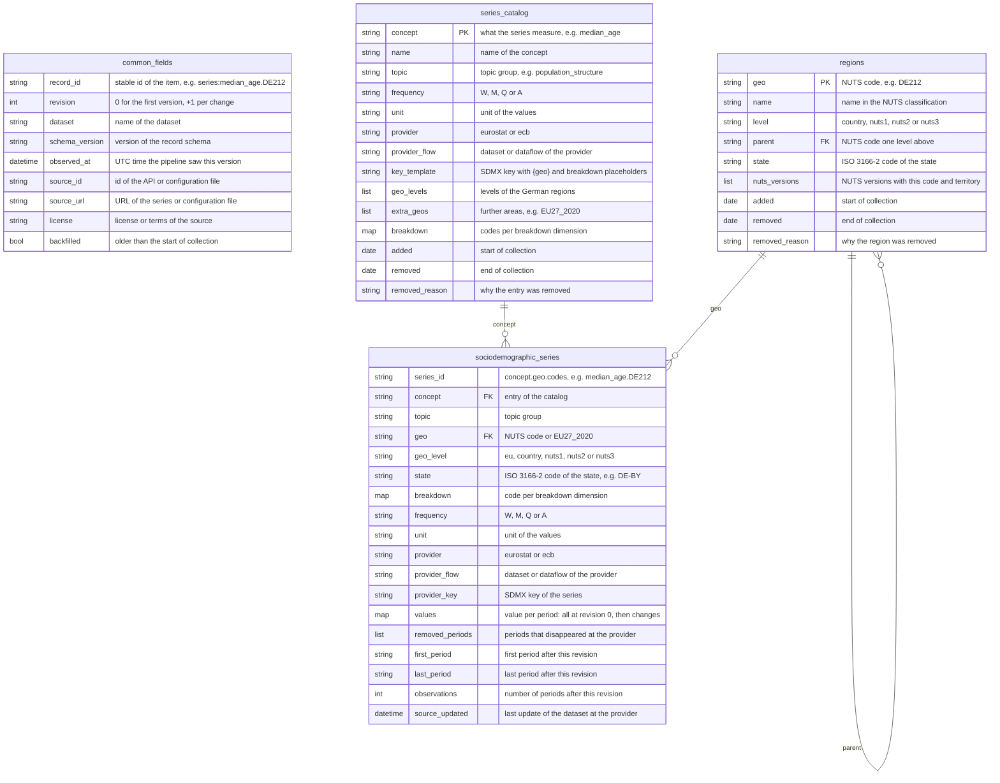
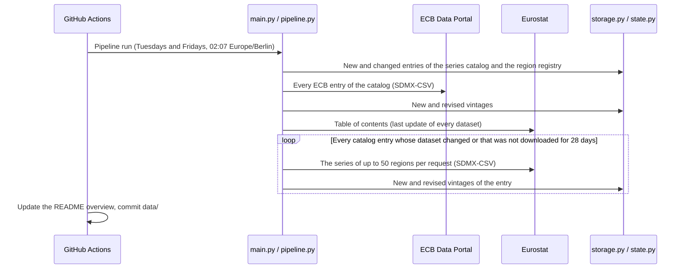

# German Sociodemographics Dataset
[](https://github.com/kleinnconrad/dataset.sociodemographics.germany/actions/workflows/ci.yml)

A dataset of German sociodemographics for analysis and prediction. A pipeline in GitHub Actions runs twice a week (Tuesdays and Fridays) for at most 30 minutes. It collects official statistics on the population by age, sex and region (age pyramid, shares of men and women), births and fertility, mortality, migration and citizenship, households, education, income classes and poverty, the distribution of wealth, housing and the regional labour market, for Germany, its 16 states, 38 government regions and 400 districts. All series are stored as vintages in partitioned JSON files in this repository, so that every past state of a revised series can be reconstructed. A monthly review checks every data source and proposes changes as a pull request.

## Table of Contents
- [Dataset Overview](#dataset-overview)
- [Datasets](#datasets)
  - [Statistical Series and Vintages](#statistical-series-and-vintages)
  - [Regions](#regions)
- [Variables](#variables)
- [Correlation with Other Datasets](#correlation-with-other-datasets)
- [Data Model](#data-model)
- [Example Records](#example-records)
- [Sources and Fetch Rules](#sources-and-fetch-rules)
- [Pipeline](#pipeline)
- [Data Files](#data-files)
- [Workflows](#workflows)
- [Configuration](#configuration)
- [Running Locally](#running-locally)
- [Continuous Integration](#continuous-integration)
- [Setup](#setup)
- [Sources and Attribution](#sources-and-attribution)

## Dataset Overview
<!-- DATASET_OVERVIEW_START -->
No run yet. The pipeline writes this overview after its first run.
<!-- DATASET_OVERVIEW_END -->

## Datasets

| Dataset | Content | Source | Kind |
|---|---|---|---|
| `sociodemographic_series` | About 34,000 statistical series of 58 concepts: population by age, sex and region, demographic balance, fertility, life expectancy, deaths, migration and citizenship, households, education, income distribution, poverty, wealth shares, housing, regional labour market and regional accounts | Eurostat, ECB | vintage |
| `series_catalog` | The catalog of the concepts with unit, frequency, provider, key template, regional levels and breakdown codes, recorded when an entry appears or changes | `config/series.toml` | change |
| `regions` | The registry of the 462 German NUTS regions (Germany, states, government regions, districts) with level, parent region, ISO 3166-2 code of the state and NUTS versions, recorded when an entry appears or changes | `config/regions.toml` | change |

**Fields of every record:** `record_id`, `revision`, `dataset`, `schema_version`, `observed_at`, `source_id`, `source_url`, `license`, `backfilled`. All other fields are defined with descriptions in [src/schema.py](src/schema.py); the variables, the regional levels and the prediction targets they serve are described in [project_architecture.md](project_architecture.md).

**Point-in-time correctness.** `observed_at` is the time at which the pipeline observed a version of a series. Filtering `observed_at <= t` gives the state of knowledge at time t, so that models can be tested on past data without information from the future. The history that a series has at its first observation is marked with `backfilled: true`.

**Aggregated statistics only.** The dataset contains published aggregates of official statistics. It contains no microdata and no data about individual persons.

### Statistical Series and Vintages

Statistical offices revise published values, and models trained on revised data overestimate what was knowable at the time. `sociodemographic_series` therefore stores vintages:

- **Revision 0** of a series holds all periods that the provider published at the first observation.
- **Every later revision** holds only the periods that were added or whose value changed, and lists the periods whose value disappeared in `removed_periods`. A run in which nothing changed writes no record.
- `first_period`, `last_period` and `observations` describe the complete series after the revision.

The series as it was known at time t is the result of applying the revisions observed at or before t in the order of `revision`:

```python
import duckdb

revisions = duckdb.sql("""
    select revision, observed_at, "values", removed_periods
    from read_json('data/sociodemographic_series/**/*.json', hive_partitioning=true)
    where series_id = 'total_fertility_rate.DE212' and observed_at <= '2027-06-01'
    order by revision
""").fetchall()
vintage = {}
for _, _, values, removed in revisions:
    vintage.update(values)
    for period in removed:
        vintage.pop(period, None)
```

**Series ids** have the form `<concept>.<geo>[.<code>...]`: the concept of the catalog, the region and one code per breakdown dimension in the order of the catalog key, e.g. `population_by_age_group.DE212.F.Y20-24` (women aged 20 to 24 in the city of München) or `median_age.DE2` (Bayern). The breakdown codes are those of the provider (Eurostat or ECB) and are also stored in the field `breakdown`, e.g. `{"sex": "F", "age": "Y20-24"}`. Common codes: `T` total, `M` males, `F` females; `Y_LT5` under 5 years, `Y5-9` 5 to 9 years, `Y_GE85` 85 years and over; `NAT` German citizens, `FOR` foreign citizens, `EU27_2020_FOR` citizens of other EU countries, `NEU27_2020_FOR` citizens of non-EU countries. The meaning of the other codes is noted in the entries of [config/series.toml](config/series.toml).

**Periods** are stored as `YYYY` (annual), `YYYY-Qn` (quarterly), `YYYY-MM` (monthly) and `YYYY-Www` (ISO weeks), the formats of dataset.economics.germany. Population stocks refer to 1 January of the year; EU-SILC indicators (income, poverty, housing) refer to the survey year, whose income reference period is the previous calendar year.

### Regions

`geo` is the NUTS code of the region, the classification of the European Union that Eurostat uses for regional statistics:

| Level | `geo_level` | Example | Regions |
|---|---|---|---|
| Germany | `country` | `DE` | 1 |
| States (Länder) | `nuts1` | `DE2` Bayern | 16 |
| Government regions and statistical regions (Regierungsbezirke) | `nuts2` | `DE21` Oberbayern | 38 |
| Districts and district-free cities (Kreise, kreisfreie Städte) | `nuts3` | `DE212` München, Kreisfreie Stadt | 400 (NUTS 2024) |
| European Union | `eu` | `EU27_2020` | 1, for comparison |

Every series of a German region carries `state`, the ISO 3166-2 code of its state (`DE-BY` for all regions in Bayern), which is the state key of dataset.politics.germany and dataset.economics.germany. The dataset `regions` lists all regions with their names and parents. NUTS 2024 changed the codes of six districts in Thüringen; the registry keeps the codes of NUTS 2016 and 2021 as well (`nuts_versions`), because Eurostat datasets that still use an earlier version publish their data under them.

Not every concept is available at every level: the population, the demographic balance, fertility, density and GDP are published down to the districts; life expectancy, infant mortality, causes of death, education, regional income, poverty, deprivation, housing costs and the labour market down to the government regions; EU-SILC distributions, migration and citizenship, households and wealth for Germany as a whole. The [Variables](#variables) table lists the levels of every concept.

## Variables

| Concept | Topic | Content | Frequency | Levels | Breakdown | Provider dataset |
|---|---|---|---|---|---|---|
| `population` | population structure | Population on 1 January by broad age group and sex | A | DE, states, gov. regions, districts | sex: T, M, F; age: TOTAL, Y_LT15, Y15-64, Y_GE65 | eurostat `demo_r_pjanaggr3` |
| `population_by_age_group` | population structure | Population on 1 January by five-year age group and sex (age pyramid) | A | DE, states, gov. regions, districts | sex: M, F; age: 18 five-year groups | eurostat `demo_r_pjangrp3` |
| `population_by_single_age` | population structure | Population on 1 January by single year of age and sex | A | DE | age: 0 to 99 and 100+; sex: M, F | eurostat `demo_pjan` |
| `median_age` | population structure | Median age of the population | A | DE, states, gov. regions, districts | none | eurostat `demo_r_pjanind3` |
| `age_dependency_ratio` | population structure | Age dependency ratios | A | DE, states, gov. regions, districts | indicator: DEPRATIO1, OLDDEP1, YOUNGDEP1 | eurostat `demo_r_pjanind3` |
| `population_density` | population structure | Population density | A | DE, states, gov. regions, districts | none | eurostat `demo_r_d3dens` |
| `demographic_balance` | population change | Population, live births, deaths, natural change, net migration, total change | A | DE, states, gov. regions, districts | indicator: JAN, LBIRTH, DEATH, NATGROW, CNMIGRAT, GROW | eurostat `demo_r_gind3` |
| `demographic_rates` | population change | Crude rates of births, deaths, natural change, net migration and population change | A | DE, states, gov. regions, districts | indicator: GBIRTHRT, GDEATHRT, NATGROWRT, CNMIGRATRT, GROWRT | eurostat `demo_r_gind3` |
| `total_fertility_rate` | births and fertility | Total fertility rate (children per woman) | A | DE, states, gov. regions, districts | none | eurostat `demo_r_find3` |
| `mean_age_at_birth` | births and fertility | Mean age of women at childbirth | A | DE, states, gov. regions, districts | none | eurostat `demo_r_find3` |
| `live_births_by_mother_age_citizenship` | births and fertility | Live births by age group and citizenship of the mother | A | DE | age: total and 15-19 to 45-49; citizen: TOTAL, NAT, FOR | eurostat `demo_faczc` |
| `women_by_age_citizenship` | births and fertility | Women on 1 January by age group and citizenship | A | DE | citizen: TOTAL, NAT, FOR; age: 15-19 to 45-49 | eurostat `migr_pop1ctz` |
| `life_expectancy` | mortality and health | Life expectancy at birth and at age 65 by sex | A | DE, states, gov. regions | sex: T, M, F; age: Y_LT1, Y65 | eurostat `demo_r_mlifexp` |
| `infant_mortality_rate` | mortality and health | Infant mortality rate | A | DE, states, gov. regions | none | eurostat `demo_r_minfind` |
| `deaths_weekly` | mortality and health | Deaths by week and sex | W | DE | sex: T, M, F | eurostat `demo_r_mwk_ts` |
| `deaths_weekly_regional` | mortality and health | Deaths by week, states and government regions | W | states, gov. regions | sex: T | eurostat `demo_r_mwk2_ts` |
| `death_rate_by_cause` | mortality and health | Standardised death rate by main cause of death | A | DE, states, gov. regions | cause: all causes, neoplasms, circulatory, respiratory, mental disorders, self-harm | eurostat `hlth_cd_asdr2` |
| `population_by_citizenship` | migration and citizenship | Population on 1 January by citizenship and sex | A | DE | citizen: TOTAL, NAT, FOR, EU27_2020_FOR, NEU27_2020_FOR; sex: T, M, F | eurostat `migr_pop1ctz` |
| `population_by_country_of_birth` | migration and citizenship | Population on 1 January by country of birth | A | DE | birth: TOTAL, NAT, FOR, EU27_2020_FOR, NEU27_2020_FOR | eurostat `migr_pop3ctb` |
| `immigration` | migration and citizenship | Immigration by citizenship | A | DE | citizen: TOTAL, NAT, EU27_2020_FOR, NEU27_2020_FOR | eurostat `migr_imm1ctz` |
| `emigration` | migration and citizenship | Emigration by citizenship | A | DE | citizen: TOTAL, NAT, EU27_2020_FOR, NEU27_2020_FOR | eurostat `migr_emi1ctz` |
| `citizenship_acquisitions` | migration and citizenship | Acquisitions of German citizenship by previous citizenship | A | DE | citizen: TOTAL, EU27_2020_FOR, NEU27_2020_FOR | eurostat `migr_acq` |
| `asylum_applicants` | migration and citizenship | Asylum applicants and first-time applicants by month | M | DE | applicant: ASY_APP, NASY_APP | eurostat `migr_asyappctzm` |
| `asylum_decisions` | migration and citizenship | First-instance decisions on asylum applications by quarter | Q | DE | decision: TOTAL, TOTAL_POS, REJECTED | eurostat `migr_asydcfstq` |
| `temporary_protection_beneficiaries` | migration and citizenship | Beneficiaries of temporary protection at the end of the month | M | DE | none | eurostat `migr_asytpsm` |
| `average_household_size` | households and families | Average household size | A | DE, EU27_2020 | none | eurostat `ilc_lvph01` |
| `young_adults_living_with_parents` | households and families | Share of young adults aged 18 to 34 living with their parents | A | DE, EU27_2020 | sex: T, M, F | eurostat `ilc_lvps08` |
| `age_leaving_parental_home` | households and families | Estimated average age of young people leaving the parental household | A | DE, EU27_2020 | sex: T, M, F | eurostat `yth_demo_030` |
| `crude_marriage_rate` | households and families | Crude marriage rate | A | DE, EU27_2020 | none | eurostat `demo_nind` |
| `crude_divorce_rate` | households and families | Crude divorce rate | A | DE, EU27_2020 | none | eurostat `demo_ndivind` |
| `educational_attainment` | education | Population aged 25 to 64 by educational attainment level and sex | A | DE, states, gov. regions, EU27_2020 | sex: T, M, F; isced: ED0-2, ED3_4, ED5-8 | eurostat `edat_lfse_04` |
| `early_leavers_from_education` | education | Early leavers from education and training aged 18 to 24 | A | DE, states, gov. regions, EU27_2020 | sex: T, M, F | eurostat `edat_lfse_16` |
| `neet_rate` | education | Young people aged 15 to 29 neither in employment nor in education and training | A | DE, states, gov. regions, EU27_2020 | sex: T, M, F | eurostat `edat_lfse_22` |
| `adult_learning` | education | Participation of adults aged 25 to 64 in education and training (last four weeks) | A | DE, states, gov. regions, EU27_2020 | sex: T, M, F | eurostat `trng_lfse_04` |
| `disposable_income_per_inhabitant` | income and poverty | Net disposable income of private households per inhabitant | A | DE, states, gov. regions | none | eurostat `nama_10r_2hhinc` |
| `primary_income_per_inhabitant` | income and poverty | Net primary income of private households per inhabitant | A | DE, states, gov. regions | none | eurostat `nama_10r_2hhinc` |
| `income_decile_shares` | income and poverty | Share of each income decile in the total equivalised disposable income (income classes) | A | DE, EU27_2020 | decile: D1 to D10 | eurostat `ilc_di01` |
| `income_decile_cut_offs` | income and poverty | Upper limits of the income deciles of equivalised disposable income | A | DE, EU27_2020 | decile: D1 to D9 | eurostat `ilc_di01` |
| `median_equivalised_income` | income and poverty | Mean and median equivalised net income | A | DE, EU27_2020 | indicator: MED_EI, MEAN_EI | eurostat `ilc_di03` |
| `gini_coefficient` | income and poverty | Gini coefficient of equivalised disposable income | A | DE, EU27_2020 | none | eurostat `ilc_di12` |
| `income_quintile_share_ratio` | income and poverty | Income quintile share ratio S80/S20 | A | DE, EU27_2020 | none | eurostat `ilc_di11` |
| `at_risk_of_poverty_rate` | income and poverty | At-risk-of-poverty rate (60 percent of the median income) by age group | A | DE, EU27_2020 | age: TOTAL, Y_LT18, Y18-64, Y_GE65 | eurostat `ilc_li02` |
| `income_quintile_share_ratio_regional` | income and poverty | Income quintile share ratio S80/S20 by region | A | DE, states, gov. regions | none | eurostat `ilc_di11_r` |
| `at_risk_of_poverty_rate_regional` | income and poverty | At-risk-of-poverty rate by region | A | DE, states, gov. regions | none | eurostat `ilc_li41` |
| `poverty_or_social_exclusion_rate_regional` | income and poverty | People at risk of poverty or social exclusion by region | A | DE, states, gov. regions | none | eurostat `ilc_peps11n` |
| `poverty_or_social_exclusion_by_citizenship` | income and poverty | People aged 18 and over at risk of poverty or social exclusion by citizenship | A | DE, EU27_2020 | citizen: NAT, FOR, EU27_2020_FOR, NEU27_2020_FOR | eurostat `ilc_peps05n` |
| `severe_material_social_deprivation` | income and poverty | Severe material and social deprivation rate | A | DE, EU27_2020 | none | eurostat `ilc_mdsd11` |
| `severe_material_social_deprivation_regional` | income and poverty | Severe material and social deprivation rate by region | A | DE, states, gov. regions | none | eurostat `ilc_mdsd18` |
| `net_wealth_share` | wealth | Share of the net wealth of households held by the wealthiest 10 and 5 percent and the poorest 50 percent | Q | DE | group: T10, T5, B50 | ecb `DWA` |
| `housing_tenure` | housing | Population by tenure status of the dwelling | A | DE, EU27_2020 | tenure: OWN, OWN_L, OWN_NL, RENT, RENT_MKT, RENT_FR | eurostat `ilc_lvho02` |
| `housing_cost_overburden_rate` | housing | Housing cost overburden rate | A | DE, EU27_2020 | none | eurostat `ilc_lvho07a` |
| `housing_cost_overburden_rate_regional` | housing | Housing cost overburden rate by region | A | DE, states, gov. regions | none | eurostat `ilc_lvho07_r` |
| `overcrowding_rate` | housing | Overcrowding rate | A | DE, EU27_2020 | none | eurostat `ilc_lvho05a` |
| `employment_rate` | labour market | Employment rate of the population aged 20 to 64 by sex | A | DE, states, gov. regions | sex: T, M, F | eurostat `lfst_r_lfe2emprt` |
| `unemployment_rate` | labour market | Unemployment rate of the population aged 15 to 74 by sex | A | DE, states, gov. regions | sex: T, M, F | eurostat `lfst_r_lfu3rt` |
| `activity_rate` | labour market | Economic activity rate of the population aged 15 to 64 by sex | A | DE, states, gov. regions | sex: T, M, F | eurostat `lfst_r_lfp2actrt` |
| `gdp_per_inhabitant` | regional economy | Gross domestic product at current prices per inhabitant | A | DE, states, gov. regions, districts | none | eurostat `nama_10r_3gdp` |
| `employment_by_place_of_work` | regional economy | Employment (persons) at the place of work | A | DE, states, gov. regions, districts | none | eurostat `nama_10r_3empers` |

The units, the meaning of the codes and the SDMX keys are in [config/series.toml](config/series.toml) and in the dataset `series_catalog`. Some variables are derived in the analysis, not stored:

- **Share of men and women** per region: `population.<geo>.M.TOTAL` and `population.<geo>.F.TOTAL` divided by `population.<geo>.T.TOTAL`.
- **Children per woman by citizenship:** five times the sum of the age-specific rates `live_births_by_mother_age_citizenship.DE.<age>.<citizen>` / `women_by_age_citizenship.DE.<citizen>.<age>` over the seven age groups 15-19 to 45-49, for `NAT` and `FOR`. The regional fertility rate is `total_fertility_rate` down to the districts; Eurostat publishes no regional fertility rate by citizenship.
- **Income classes:** the deciles of `income_decile_shares` and their upper limits in `income_decile_cut_offs`; regional income levels in `disposable_income_per_inhabitant`.
- **Age pyramid:** `population_by_age_group` by region, `population_by_single_age` for Germany.

## Correlation with Other Datasets

The dataset is built to be correlated with [dataset.politics.germany](https://github.com/kleinnconrad/dataset.politics.germany), [dataset.economics.germany](https://github.com/kleinnconrad/dataset.economics.germany), [dataset.technology](https://github.com/kleinnconrad/dataset.technology) and [dataset.fashion](https://github.com/kleinnconrad/dataset.fashion):

- **Time:** periods use the formats of dataset.economics.germany (`YYYY`, `YYYY-Qn`, `YYYY-MM`, `YYYY-Www`); aggregate the event and day data of the other datasets to these periods. `observed_at` keeps joins point-in-time correct.
- **Germany and the EU:** `geo` `DE` and `EU27_2020` are the codes of the series of dataset.economics.germany and of the Eurostat indicators of dataset.technology. Countries are ISO 3166-1 alpha-2 codes in dataset.fashion (`source_country`) and in most datasets of dataset.technology; the World Bank indicators there use alpha-3 (`DEU`).
- **States:** `state` (ISO 3166-2, e.g. `DE-BY`) equals `jurisdiction`, `home_state` and `states_concerned` of dataset.politics.germany (polls for the state parliaments, regional outlets, annotations) and `home_state` and `states_concerned` of dataset.economics.germany. State-level series (`geo_level = nuts1`) join directly; series of government regions and districts aggregate to their state.
- **Regions below the states:** NUTS codes are the keys of the regional statistics of Eurostat and of the GISCO maps, so further regional data can be added.

Examples and further keys are described in [project_architecture.md](project_architecture.md#4-correlation-with-other-datasets).

## Data Model

The diagram shows the three datasets with all their fields and the fields that link them. Each field has a short comment; the full descriptions are in [src/schema.py](src/schema.py).

- **`common_fields`** lists the nine fields that every record of every dataset has. They are not repeated in the dataset entities.
- **Types:** `list` and `map` are JSON arrays and objects; the comment names their content.



## Example Records

One record per dataset. The examples are linked: the series `median_age.DE212` belongs to the catalog entry `median_age` and to the region `DE212`. **The values of the series example are placeholders that show the structure;** they will be replaced with a record of the first run.

<details>
<summary><code>sociodemographic_series</code>: the median age in the city of München at its first observation (placeholder values)</summary>

```json
{
  "record_id": "series:median_age.DE212",
  "revision": 0,
  "dataset": "sociodemographic_series",
  "schema_version": "1.0",
  "observed_at": "2026-10-27T01:12:40Z",
  "source_id": "eurostat",
  "source_url": "https://ec.europa.eu/eurostat/api/dissemination/sdmx/2.1/data/demo_r_pjanind3/A.MEDAGEPOP.YR.DE212",
  "license": "Eurostat (reuse authorised with acknowledgement of the source)",
  "backfilled": true,
  "series_id": "median_age.DE212",
  "concept": "median_age",
  "topic": "population_structure",
  "geo": "DE212",
  "geo_level": "nuts3",
  "state": "DE-BY",
  "breakdown": {},
  "frequency": "A",
  "unit": "years",
  "provider": "eurostat",
  "provider_flow": "demo_r_pjanind3",
  "provider_key": "A.MEDAGEPOP.YR.DE212",
  "values": {"2023": 0.0, "2024": 0.0, "2025": 0.0},
  "removed_periods": [],
  "first_period": "2023",
  "last_period": "2025",
  "observations": 3,
  "source_updated": null
}
```

</details>

<details>
<summary><code>series_catalog</code>: the catalog entry of the median age</summary>

```json
{
  "record_id": "series_catalog:median_age",
  "revision": 0,
  "dataset": "series_catalog",
  "schema_version": "1.0",
  "observed_at": "2026-10-27T01:07:02Z",
  "source_id": "registry",
  "source_url": "https://github.com/kleinnconrad/dataset.sociodemographics.germany/blob/main/config/series.toml",
  "license": "Configuration of this project; no license granted",
  "backfilled": false,
  "concept": "median_age",
  "name": "Median age of the population",
  "topic": "population_structure",
  "frequency": "A",
  "unit": "years",
  "provider": "eurostat",
  "provider_flow": "demo_r_pjanind3",
  "key_template": "A.MEDAGEPOP.YR.{geo}",
  "geo_levels": ["country", "nuts1", "nuts2", "nuts3"],
  "extra_geos": [],
  "breakdown": {},
  "added": "2026-10-26",
  "removed": null,
  "removed_reason": null
}
```

</details>

<details>
<summary><code>regions</code>: the city of München</summary>

```json
{
  "record_id": "regions:DE212",
  "revision": 0,
  "dataset": "regions",
  "schema_version": "1.0",
  "observed_at": "2026-10-27T01:07:02Z",
  "source_id": "registry",
  "source_url": "https://github.com/kleinnconrad/dataset.sociodemographics.germany/blob/main/config/regions.toml",
  "license": "Configuration of this project; no license granted",
  "backfilled": false,
  "geo": "DE212",
  "name": "München, Kreisfreie Stadt",
  "level": "nuts3",
  "parent": "DE21",
  "state": "DE-BY",
  "nuts_versions": ["2016", "2021", "2024"],
  "added": "2026-10-26",
  "removed": null,
  "removed_reason": null
}
```

</details>

## Sources and Fetch Rules

- **APIs:** the dissemination API of Eurostat and the ECB Data Portal (SDMX 2.1 REST, SDMX-CSV) and the table of contents of Eurostat. These documented interfaces are used under their terms, without keys.
- **Websites:** only the terms pages of the providers, which the monthly source review reads. Every website request is checked against the robots.txt of its host for the user agent `GermanSociodemographicsDataset`, with the longest-match rule of RFC 9309, and against text-and-data-mining reservations (TDMRep).
- **Bot protection:** a provider that answers with HTTP 401/403, a challenge page or a CAPTCHA stops its collector with an error. The pipeline does not use a headless browser.
- **Pacing:** at most one request per second per host, retries for server errors and rate limits. The User-Agent names the repository; no personal data is sent.
- **Unchanged datasets:** the Eurostat collector reads the table of contents of Eurostat first and skips catalog entries whose dataset has not been updated since their last download; every entry is downloaded again after 28 days at the latest.
- **Source review:** on the first day of every month, `source_review.yml` checks every catalog entry, the regions and the terms of the providers and proposes changes as a pull request (see [Workflows](#workflows)).

## Pipeline



**Run deadline.** The collectors start no new work 25 minutes after the start of the run (`RUN_DEADLINE_MINUTES`), so that the workflow commits the data before its timeout of 30 minutes. A collector that stops at the deadline has the status `partial` and continues in the next run; a collector that has not started by then is skipped.

Each collector runs in isolation: a failure is logged in `data/state/collectors.json` and the run log, the other collectors continue, and the data already written is kept. A catalog entry without data (discontinued dataset or wrong key) is counted and listed in the run log; the other entries continue. The run ends with exit code 1 if a collector failed, so that the workflow fails visibly.

## Data Files

| Path | Content |
|---|---|
| `data/<dataset>/year=YYYY/month=MM/<dataset>_YYYY-MM-DD.json` | Records of a dataset observed on one UTC day |
| `data/state/seen/<dataset>.json` | Catalog entries and regions already written, with content hash and revision |
| `data/state/seen/sociodemographic_series/<concept>/<shard>.json` | Current values of the series of a concept in one state (`DE1` to `DEG`) or of Germany and the EU (`DE`, `EU27_2020`), compared with the next download |
| `data/state/collectors.json` | First run, last run, failures and cursor per collector (with the last download and dataset update of every catalog entry) |
| `data/state/run_log.jsonl` | One line per run with the outcome and counters of each collector |
| `reviews/YYYY-MM.md` | Report of the monthly source review |

Each data file is a JSON list with one record per line. The folder names `year=` and `month=` let DuckDB, Polars and pyarrow read a dataset as one table:

```python
import duckdb
series = duckdb.sql("""
    select series_id, geo, state, breakdown, "values"
    from read_json('data/sociodemographic_series/**/*.json', hive_partitioning=true)
    where concept = 'total_fertility_rate' and geo_level = 'nuts3'
""").df()
```

## Workflows

| Workflow | Schedule | Purpose |
|---|---|---|
| `pipeline.yml` | Tuesdays and Fridays, 02:07 Europe/Berlin | Runs the collectors (timeout 30 minutes), updates the overview and commits `data/` and `README.md` |
| `notify.yml` | After each `normal` or `backfill` run of `pipeline.yml` | Posts a summary of the run (status and records per collector, new and revised series, entries without data) as a commit comment that mentions the repository owner |
| `source_review.yml` | First day of every month, 07:17 Europe/Berlin | Reviews the data sources and opens a pull request with the report in `reviews/` and changed terms hashes in `config/providers.toml` |
| `ci.yml` | Pull requests, pushes to `main` | Lint, tests and commit message checks |

**Notification email.** GitHub sends an email for the mention in the comment of `notify.yml` if email notifications for participating and @mentions are enabled (the default, under **Settings > Notifications** of the GitHub account). The summary is built by `scripts/run_summary.py` from the last line of `data/state/run_log.jsonl`.

**Source review.** `source_review.yml` (code in [src/source_review.py](src/source_review.py)) revises the data sources every month and opens a pull request from the branch `source-review`:
- **Catalog entries:** every active entry is fetched for the last three years. The report lists entries without data or with a failing key, levels or regions without data, missing series and newest periods that are older than expected for the frequency. For an entry without data it adds the dimensions of the dataset and the codes it has for Germany, so that the key can be corrected.
- **Datasets:** catalog datasets that the table of contents of Eurostat no longer lists (discontinued or renamed), with possible successors, and new or restructured datasets on the topics of the catalog as candidates.
- **Regions:** German NUTS codes that Eurostat publishes and the registry lacks, e.g. after a new version of the NUTS classification.
- **State and runs:** catalog entries without stored series, stale stored series and entries that had no data or failed in the runs of the last 35 days.
- **Terms of use:** the terms page of every provider is fetched and the hash of its text compared with `config/providers.toml`. A changed text is reported and its new hash is part of the pull request; read the terms before merging.

Changes of the catalog and the region registry are proposed in the report only, because they need a verified key and an entry in the measurement log. A pull request opened with the `GITHUB_TOKEN` starts no workflows, so the review starts `ci.yml` on its branch. The next review rebuilds the branch, so merge or close the pull request before the first day of the next month. Started by hand with `pull_request` off, the review writes its report to the job summary only; with `concepts`, it checks only the listed catalog entries, e.g. to verify a new key.

**Manual runs.** The workflows can be started by hand: open the **Actions** tab, select **German Sociodemographics Pipeline** (or **Source Review**, **CI**), click **Run workflow**, and choose the branch and the inputs. The modes of `pipeline.yml`:
- `normal`: same as the scheduled run; commits the data.
- `backfill`: downloads every catalog entry, also those whose dataset is unchanged, and commits the data (timeout 90 minutes).
- `shadow`: runs on a copy of the state in a temporary folder and uploads the output as an artifact; nothing is committed.
- `dry-run`: runs the collectors without writing any data.

The input `collectors` restricts a manual run to a comma-separated list of collectors, e.g. `eurostat`.

## Configuration

| Variable | Default | Purpose |
|---|---|---|
| `RUN_DEADLINE_MINUTES` | 25 | Minutes after the start after which the collectors start no new work (85 in `backfill` runs) |
| `FULL_CHECK_DAYS` | 28 | Days after which a catalog entry is downloaded again although Eurostat reports its dataset as unchanged |
| `COLLECTORS` | all | Comma-separated list of collectors to run |

The pipeline needs no secrets. The series, regions and providers are configured in [config/series.toml](config/series.toml), [config/regions.toml](config/regions.toml) and [config/providers.toml](config/providers.toml). Fixed thresholds, such as the share of removed periods that marks a response as incomplete, are constants in the modules that use them.

## Running Locally

```bash
uv sync
uv run python src/main.py --dry-run                                   # fetch everything, write nothing
uv run python src/main.py --collectors series_catalog,regions         # registries only, no requests
uv run python src/main.py --collectors eurostat                       # Eurostat series
uv run python src/main.py --backfill                                  # download every catalog entry
uv run python src/generate_dataset_overview.py                        # README overview
uv run python src/source_review.py --report review.md --concepts median_age   # review one entry
```

Local runs write to `~/Downloads/german_sociodemographics_dataset/` unless `--output-dir` is given; in GitHub Actions they write to `data/`. Environment variables can be set in a `.env` file in the repository root, which is listed in `.gitignore`. The collectors, in the order of a run, are `series_catalog`, `regions`, `ecb` and `eurostat`.

## Continuous Integration

The `CI` workflow runs on every pull request and on pushes to `main`:

| Job | Checks |
|---|---|
| `Lint` | `uv.lock` matches `pyproject.toml`; `ruff check`; `actionlint` (including `shellcheck`) on the workflow files |
| `Tests` | The tests in `tests/` on Python 3.11 and 3.14. They run offline with a fake web and check that every module imports, that the configuration files are valid, that the record schema matches its snapshot and that the README matches the schema and the catalog. |
| `Conventional Commits` | Every commit of a pull request follows the Conventional Commits format (pull requests only) |
| `CI passed` | Succeeds only if all jobs above succeeded or were skipped; use it as the required status check of `main` |

Dependencies are managed with [uv](https://docs.astral.sh/uv/): `pyproject.toml` declares them, `uv.lock` pins them, and Dependabot proposes weekly updates. Run the checks locally before pushing:

```bash
uv lock --check
uv run ruff check .
uv run pytest
```

## Setup

1. Under **Settings > Actions > General > Workflow permissions**, choose read and write permissions, so that the workflows can push, and allow GitHub Actions to create and approve pull requests, so that the source review can open its pull request.
2. Start `source_review.yml` once by hand with `pull_request` off, to check every catalog entry against the live providers.
3. Start `pipeline.yml` once by hand in the mode `backfill`, or wait for the next scheduled run. The first run imports the history of all series (from 1990 for the population of the districts); an offline test with synthetic responses of the same size processed about 34,000 series in under two minutes, so the run time is set by the about 170 requests to the providers.

## Sources and Attribution

No license is granted for the code or the data of this repository. The data contains material of third parties, which remains subject to the terms of its sources; the field `license` of every record names them:

| Source | Datasets | Terms and required attribution |
|---|---|---|
| Eurostat (https://ec.europa.eu/eurostat) | `sociodemographic_series` | Reuse authorised with acknowledgement of the source: "Source: Eurostat". Most series are compiled from the data of the Statistisches Bundesamt (Destatis) and the statistical offices of the states. |
| European Central Bank, ECB Data Portal (https://data.ecb.europa.eu) | `sociodemographic_series` (Distributional Wealth Accounts) | Reuse free of charge with acknowledgement of the source: "Source: ECB statistics". The Distributional Wealth Accounts are experimental statistics. |
| Eurostat, NUTS classification (https://github.com/eurostat/Nuts2json) | codes and names of `regions` | Codes and names of the NUTS classification of the European Union. |
