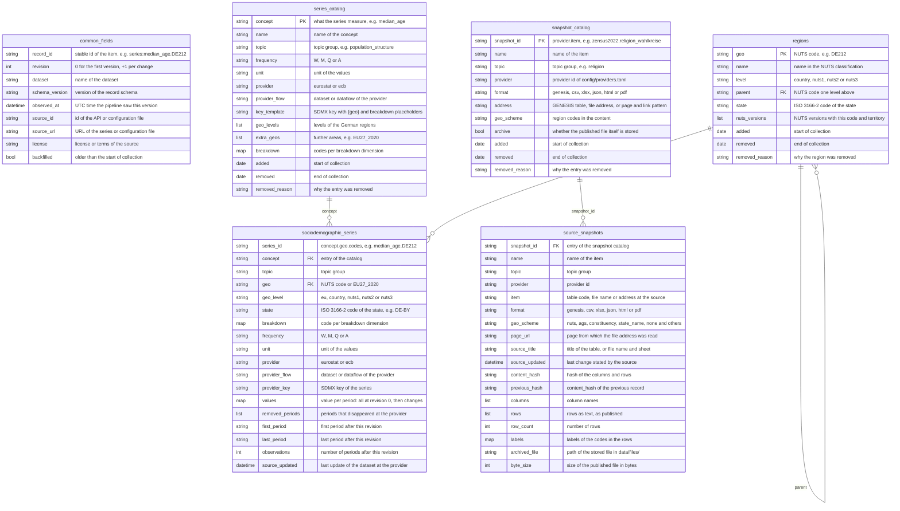
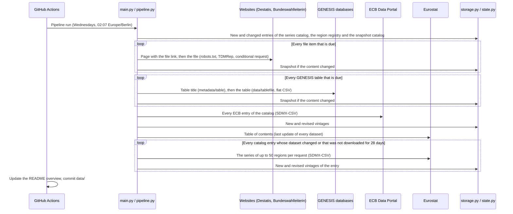

# German Sociodemographics Dataset
[](https://github.com/kleinnconrad/dataset.sociodemographics.germany/actions/workflows/ci.yml)

Building a dataset of German sociodemographics for analysis and prediction. A pipeline in GitHub Actions runs once a week (Wednesdays). Its main purpose is to persist volatile data: tables and files that their sources overwrite, delete, publish only as the current state or revise without versions, such as the tables of GENESIS-Online, the weekly provisional death counts, the special evaluations of the Zensus 2022 on religious affiliation and the structural data of the Bundestag constituencies. The pipeline stores what such a source published at every observation and thereby builds the history that the source does not keep. The stable backbone are the series of Eurostat and the ECB on the population by age, sex and region (age pyramid, shares of men and women), births and fertility, mortality, migration and citizenship, households, education, income classes and poverty, the distribution of wealth, housing, the regional labour market and crime, for Germany, its 16 states, 38 government regions and 400 districts; they are stored as vintages, so that every past state of a revised series can be reconstructed. All records are partitioned JSON files in this repository. A monthly review checks every data source and proposes changes as a pull request.

## Table of Contents
- [Variable Overview](#variable-overview)
- [Dataset Overview](#dataset-overview)
- [Datasets](#datasets)
  - [Statistical Series and Vintages](#statistical-series-and-vintages)
  - [Snapshots of Volatile Sources](#snapshots-of-volatile-sources)
  - [Regions](#regions)
- [Variables](#variables)
- [Correlation with Other Datasets](#correlation-with-other-datasets)
- [Data Model](#data-model)
- [Example Records](#example-records)
- [Sources and Fetch Rules](#sources-and-fetch-rules)
- [Pipeline](#pipeline)
- [Data Files](#data-files)
- [Workflows](#workflows)
- [Configuration](#configuration)
- [Running Locally](#running-locally)
- [Continuous Integration](#continuous-integration)
- [Setup](#setup)
- [Sources and Attribution](#sources-and-attribution)

## Variable Overview

The table lists the variables that carry content and the dataset (table) that stores them. Statistical series are grouped by topic: every concept of a topic is stored per region and breakdown code as a series `<concept>.<geo>[.<code>...]` in `sociodemographic_series`, with the values by period in the field `values`, the region in `geo`, `geo_level` and `state` and the codes of sex, age, citizenship and other dimensions in `breakdown`; the example names a series, a period, the value and the unit. All concepts are listed in [Variables](#variables) and in [config/series.toml](config/series.toml). Snapshot tables are grouped by the same topics: each published item of a topic is stored in `source_snapshots` with its content in `columns` and `rows` (cells as text, as the source wrote them, e.g. with decimal commas), the labels of the codes of GENESIS tables in `labels` and the scheme of the region codes in `geo_scheme`; the example names an item, the row and column of a cell and the published cell. All items are listed in [Snapshots of Volatile Sources](#snapshots-of-volatile-sources) and in [config/snapshots.toml](config/snapshots.toml). Not listed are the fields that every record has, ids that link the datasets or the regions, providers with their keys and table codes, names, titles and formats of the snapshot items, URLs, coverage dates, NUTS versions, the bookkeeping of revisions and snapshots (periods, counts, hashes, file paths and sizes, update times) and the catalogs `series_catalog` and `snapshot_catalog`, which describe the collection; all fields are in the [Data Model](#data-model).

| Variable | Table | Description | Example |
|---|---|---|---|
| Series of topic `population_structure` | `sociodemographic_series` | Population on 1 January by sex and by broad, five-year and single-year age group (age pyramid), median age, age dependency ratios, population density; annual; down to the districts, single years of age for Germany | `population_by_age_group.DE212.F.Y20-24` 2025: `46993.0` (persons on 1 January) |
| Series of topic `population_change` | `sociodemographic_series` | Population on 1 January; live births, deaths, natural change, net migration and total change as counts and as crude rates per 1,000 persons; annual; down to the districts | `demographic_balance.DE.CNMIGRAT` 2025: `242324.0` (persons) |
| Series of topic `births_and_fertility` | `sociodemographic_series` | Total fertility rate and mean age of women at childbirth, down to the districts; live births by age group and citizenship of the mother and women by age group and citizenship, for Germany; annual | `total_fertility_rate.DE` 2024: `1.36` (live births per woman) |
| Series of topic `mortality_and_health` | `sociodemographic_series` | Life expectancy at birth and at age 65 by sex, infant mortality rate and standardised death rates by main cause of death, annual, down to the government regions; deaths by week, by sex for Germany and per state | `life_expectancy.DE.T.Y_LT1` 2024: `81.2` (years) |
| Series of topic `migration_and_citizenship` | `sociodemographic_series` | Population by citizenship and by country of birth, immigration and emigration by citizenship, acquisitions of German citizenship (annual); asylum applicants and beneficiaries of temporary protection (monthly), first-instance asylum decisions (quarterly); Germany | `immigration.DE.TOTAL` 2024: `1078504.0` (persons) |
| Series of topic `households_and_families` | `sociodemographic_series` | Average household size, share of young adults living with their parents, age at leaving the parental home, crude marriage and divorce rates; annual; Germany and EU27_2020 | `average_household_size.DE` 2025: `2.0` (persons per household) |
| Series of topic `education` | `sociodemographic_series` | Educational attainment of the population aged 25 to 64 by ISCED level, early leavers from education and training, NEET rate, participation of adults in education and training, by sex; annual; down to the government regions, EU27_2020 for comparison | `educational_attainment.DE.T.ED5-8` 2025: `35.4` (percent of the population aged 25 to 64) |
| Series of topic `income_and_poverty` | `sociodemographic_series` | Net disposable and primary income of households per inhabitant, income decile shares and cut-offs, mean and median equivalised income, Gini coefficient, S80/S20 ratio, at-risk-of-poverty rate, poverty or social exclusion rate (also by citizenship), severe material and social deprivation; annual; Germany and EU27_2020, regional indicators down to the government regions | `at_risk_of_poverty_rate.DE.TOTAL` 2025: `16.1` (percent of the population) |
| Series of topic `wealth` | `sociodemographic_series` | Shares of the wealthiest 10 and 5 percent and the poorest 50 percent of households in the total net wealth of households; quarterly; Germany | `net_wealth_share.DE.T10` 2026-Q1: `59.37` (percent of the total net wealth of households) |
| Series of topic `housing` | `sociodemographic_series` | Population by tenure status (owners, tenants), housing cost overburden rate, overcrowding rate; annual; Germany and EU27_2020, housing cost overburden down to the government regions | `housing_tenure.DE.OWN` 2025: `47.2` (percent of the population) |
| Series of topic `labour_market` | `sociodemographic_series` | Employment rate (20 to 64), unemployment rate (15 to 74) and activity rate (15 to 64) by sex; annual; down to the government regions | `unemployment_rate.DE.T` 2025: `3.8` (percent of the labour force aged 15 to 74) |
| Series of topic `regional_economy` | `sociodemographic_series` | GDP at current prices per inhabitant and employment at the place of work; annual; down to the districts | `gdp_per_inhabitant.DE212` 2023: `100900.0` (euro per inhabitant) |
| Series of topic `crime_and_justice` | `sociodemographic_series` | Offences recorded by the police by ICCS category, persons suspected and convicted by citizenship, persons held in prisons and official prison capacity; annual; Germany | `prison_population.DE.PRIS_ACT_CAP` 2024: `58798.0` (persons) |
| Snapshot tables of topic `population_structure` | `source_snapshots` | Persons by five-year age group and by sex, German citizens in five age groups; per Bundestag constituency; Zensus 2022 (15 May 2022) | `zensus2022.1000A-1W04` constituency `WKR297` (Saarlouis), 55 to 59 years, 2022-05-15: `24754` (persons) |
| Snapshot tables of topic `births_and_fertility` | `source_snapshots` | Live births by month and sex, for Germany and per state, and by state and citizenship of the child and the parents; total fertility rate by state and by citizenship of the mother; GENESIS-Online | `destatis.12612-0010` foreign mother (`AUSLAENDISCH`), 2025: `1,778` (children per woman) |
| Snapshot tables of topic `mortality_and_health` | `source_snapshots` | Deaths by month and sex, for Germany and per state (GENESIS-Online); deaths by day, by calendar week and age group, and by month, state and age group from the weekly report, provisional and revised every week | `destatis.sterbefaelle_wochen_alter` Germany, all ages, 2026 week 41: `17653` (deaths, provisional) |
| Snapshot tables of topic `migration_and_citizenship` | `source_snapshots` | Population by migration status (Mikrozensus); foreigners by citizenship and per district, persons seeking protection for Germany and per district (Central Register of Foreigners); persons by migration history, country of birth and citizenship and the share of foreigners per Bundestag constituency (Zensus 2022) | `destatis.12521-0040` München, kreisfreie Stadt (`09162`), 2025-12-31: `538785` (foreigners) |
| Snapshot tables of topic `households_and_families` | `source_snapshots` | Population by marital status per Bundestag constituency; Zensus 2022 | `zensus2022.familienstand_wahlkreise` constituency `001`, married: `120780` (persons) |
| Snapshot tables of topic `income_and_poverty` | `source_snapshots` | Private households by household size and monthly net income class (Mikrozensus); annual; Germany | `destatis.12211-0300` households of 2 persons, 3,500 to under 4,000 EUR, 2025: `1491` (thousand households) |
| Snapshot tables of topic `labour_market` | `source_snapshots` | Unemployed persons by group (foreign, long-term unemployed, severely disabled, age groups) and unemployment rates by sex, citizenship and age; annual average; Germany, states, government regions and districts (Regionaldatenbank) | `regionalstatistik.13211-02-05-4` München, kreisfreie Stadt (`09162`), 2025: `5,4` (unemployment rate, percent of the civilian labour force) |
| Snapshot tables of topic `religion` | `source_snapshots` | Population by religious affiliation (Roman Catholic Church, Protestant Church, other or none) per municipality, district and state in the Zensus 2011 and 2022, and per Bundestag constituency, regional church of the EKD and Catholic diocese in the Zensus 2022; per regional church and diocese also by migration history, citizenship, sex and age group | `zensus2022.religion_gemeinden_2022` Flensburg, Stadt (`010010000000`), share of the Roman Catholic Church: `5,5%` |
| Snapshot tables of topic `regional_structure` | `source_snapshots` | Structural data per Bundestag constituency for the elections 2017, 2021 and 2025: area, population, foreigners, age groups, natural change and migration balance, housing, motor vehicles, enterprises, school leavers, child care, disposable income, GDP, employment by sector, recipients of basic income support (SGB II), unemployment rates | `bundeswahlleiterin.btw2025_strukturdaten` constituency 1 (Flensburg – Schleswig), population density on 31 December 2023: `141,5` (inhabitants per km²) |
| Snapshot tables of topic `crime_and_justice` | `source_snapshots` | Offences recorded and cleared and suspects by nationality and sex (Polizeiliche Kriminalstatistik); convicted persons by offence, nationality, sex and age (Strafverfolgungsstatistik); prisoners by type of detention, nationality, sex and age, for Germany and per state (Strafvollzugsstatistik); persons with pre-trial detention by citizenship and state in 2014, 2017 and 2019; annual | `destatis.24911-0001` Germany, 2025, recorded offences: `5508559` (offences) |
| `name` | `regions` | Name of the region in the NUTS classification | `München, Kreisfreie Stadt` |
| `level` | `regions` | Level of the region: country, nuts1 (state), nuts2 (government region) or nuts3 (district) | `nuts3` |
| `state` | `regions` | State that contains the region (ISO 3166-2) | `DE-BY` |

## Dataset Overview
<!-- DATASET_OVERVIEW_START -->
**Last updated:** 2026-10-26 13:16 UTC

| Dataset | Records | Items | Files | Observed | Content |
|---|---|---|---|---|---|
| `sociodemographic_series` | 34,441 | 34,441 | 1 | 2026-10-26 to 2026-10-26 | A vintage of a statistical series: all values at the first observation, then the added, revised and removed periods. |
| `series_catalog` | 61 | 61 | 1 | 2026-10-26 to 2026-10-26 | An entry of the series catalog, recorded when it appears or changes. |
| `regions` | 462 | 462 | 1 | 2026-10-26 to 2026-10-26 | An entry of the region registry, recorded when it appears or changes. |
| `source_snapshots` | 54 | 54 | 1 | 2026-10-26 to 2026-10-26 | The content that a source without a reliable history published at one observation, stored again only when it changes. |
| `snapshot_catalog` | 54 | 54 | 1 | 2026-10-26 to 2026-10-26 | An entry of the snapshot configuration, recorded when it appears or changes. |

**Runs**

- **Latest run:** 2026-10-26 12:55 UTC (normal)
  - `ecb`: ok (sociodemographic_series 3)
  - `eurostat`: ok (sociodemographic_series 34,438)
  - `files`: ok (source_snapshots 15)
  - `genesis`: ok (source_snapshots 39)
  - `regions`: ok (regions 462)
  - `series_catalog`: ok (series_catalog 61)
  - `snapshot_catalog`: ok (snapshot_catalog 54)

**Statistical series**

- **Active catalog entries:** 61 (eurostat 60, ecb 1); with stored series: 61; stored series: 34,441

<details>
<summary>Catalog entries: stored series, levels and latest period</summary>

| Concept | Topic | Frequency | Unit | Dataset | Series | Levels | Latest period | Revised records |
|---|---|---|---|---|---|---|---|---|
| `live_births_by_mother_age_citizenship` | births and fertility | A | live births | eurostat `demo_faczc` | 24 | country | 2024 | 0 |
| `mean_age_at_birth` | births and fertility | A | years | eurostat `demo_r_find3` | 462 | country, nuts1, nuts2, nuts3 | 2024 | 0 |
| `total_fertility_rate` | births and fertility | A | live births per woman | eurostat `demo_r_find3` | 462 | country, nuts1, nuts2, nuts3 | 2024 | 0 |
| `women_by_age_citizenship` | births and fertility | A | persons on 1 January | eurostat `migr_pop1ctz` | 28 | country | 2025 | 0 |
| `criminal_justice_persons_by_citizenship` | crime and justice | A | persons | eurostat `crim_just_ctz` | 6 | country | 2024 | 0 |
| `police_recorded_offences` | crime and justice | A | offences | eurostat `crim_off_cat` | 20 | country | 2024 | 0 |
| `prison_population` | crime and justice | A | persons | eurostat `crim_pris_cap` | 2 | country | 2024 | 0 |
| `adult_learning` | education | A | percent of the population aged 25 to 64 | eurostat `trng_lfse_04` | 168 | eu, country, nuts1, nuts2 | 2025 | 0 |
| `early_leavers_from_education` | education | A | percent of the population aged 18 to 24 | eurostat `edat_lfse_16` | 165 | eu, country, nuts1, nuts2 | 2025 | 0 |
| `educational_attainment` | education | A | percent of the population aged 25 to 64 | eurostat `edat_lfse_04` | 504 | eu, country, nuts1, nuts2 | 2025 | 0 |
| `neet_rate` | education | A | percent of the population aged 15 to 29 | eurostat `edat_lfse_22` | 167 | eu, country, nuts1, nuts2 | 2025 | 0 |
| `age_leaving_parental_home` | households and families | A | years | eurostat `yth_demo_030` | 6 | eu, country | 2025 | 0 |
| `average_household_size` | households and families | A | persons per household | eurostat `ilc_lvph01` | 2 | eu, country | 2025 | 0 |
| `crude_divorce_rate` | households and families | A | divorces per 1,000 persons | eurostat `demo_ndivind` | 2 | eu, country | 2024 | 0 |
| `crude_marriage_rate` | households and families | A | marriages per 1,000 persons | eurostat `demo_nind` | 2 | eu, country | 2024 | 0 |
| `young_adults_living_with_parents` | households and families | A | percent of the population aged 18 to 34 | eurostat `ilc_lvps08` | 6 | eu, country | 2025 | 0 |
| `housing_cost_overburden_rate` | housing | A | percent of the population | eurostat `ilc_lvho07a` | 2 | eu, country | 2025 | 0 |
| `housing_cost_overburden_rate_regional` | housing | A | percent of the population | eurostat `ilc_lvho07_r` | 55 | country, nuts1, nuts2 | 2025 | 0 |
| `housing_tenure` | housing | A | percent of the population | eurostat `ilc_lvho02` | 12 | eu, country | 2025 | 0 |
| `overcrowding_rate` | housing | A | percent of the population | eurostat `ilc_lvho05a` | 2 | eu, country | 2025 | 0 |
| `at_risk_of_poverty_rate` | income and poverty | A | percent of the population | eurostat `ilc_li02` | 8 | eu, country | 2025 | 0 |
| `at_risk_of_poverty_rate_regional` | income and poverty | A | percent of the population | eurostat `ilc_li41` | 55 | country, nuts1, nuts2 | 2025 | 0 |
| `disposable_income_per_inhabitant` | income and poverty | A | euro per inhabitant | eurostat `nama_10r_2hhinc` | 55 | country, nuts1, nuts2 | 2023 | 0 |
| `gini_coefficient` | income and poverty | A | index from 0 to 100 | eurostat `ilc_di12` | 2 | eu, country | 2025 | 0 |
| `income_decile_cut_offs` | income and poverty | A | euro per year | eurostat `ilc_di01` | 18 | eu, country | 2025 | 0 |
| `income_decile_shares` | income and poverty | A | percent of the total equivalised disposable income | eurostat `ilc_di01` | 20 | eu, country | 2025 | 0 |
| `income_quintile_share_ratio` | income and poverty | A | ratio of the income of the top and the bottom fifth | eurostat `ilc_di11` | 2 | eu, country | 2025 | 0 |
| `income_quintile_share_ratio_regional` | income and poverty | A | ratio of the income of the top and the bottom fifth | eurostat `ilc_di11_r` | 55 | country, nuts1, nuts2 | 2025 | 0 |
| `median_equivalised_income` | income and poverty | A | euro per year | eurostat `ilc_di03` | 4 | eu, country | 2025 | 0 |
| `poverty_or_social_exclusion_by_citizenship` | income and poverty | A | percent of the population aged 18 and over | eurostat `ilc_peps05n` | 8 | eu, country | 2025 | 0 |
| `poverty_or_social_exclusion_rate_regional` | income and poverty | A | percent of the population | eurostat `ilc_peps11n` | 55 | country, nuts1, nuts2 | 2025 | 0 |
| `primary_income_per_inhabitant` | income and poverty | A | euro per inhabitant | eurostat `nama_10r_2hhinc` | 55 | country, nuts1, nuts2 | 2023 | 0 |
| `severe_material_social_deprivation` | income and poverty | A | percent of the population | eurostat `ilc_mdsd11` | 2 | eu, country | 2025 | 0 |
| `severe_material_social_deprivation_regional` | income and poverty | A | percent of the population | eurostat `ilc_mdsd18` | 55 | country, nuts1, nuts2 | 2025 | 0 |
| `activity_rate` | labour market | A | percent of the population aged 15 to 64 | eurostat `lfst_r_lfp2actrt` | 165 | country, nuts1, nuts2 | 2025 | 0 |
| `employment_rate` | labour market | A | percent of the population aged 20 to 64 | eurostat `lfst_r_lfe2emprt` | 165 | country, nuts1, nuts2 | 2025 | 0 |
| `unemployment_rate` | labour market | A | percent of the labour force aged 15 to 74 | eurostat `lfst_r_lfu3rt` | 165 | country, nuts1, nuts2 | 2025 | 0 |
| `asylum_applicants` | migration and citizenship | M | persons | eurostat `migr_asyappctzm` | 3 | country | 2026-07 | 0 |
| `asylum_decisions` | migration and citizenship | Q | persons | eurostat `migr_asydcfstq` | 6 | country | 2026-Q2 | 0 |
| `citizenship_acquisitions` | migration and citizenship | A | persons | eurostat `migr_acq` | 3 | country | 2024 | 0 |
| `emigration` | migration and citizenship | A | persons | eurostat `migr_emi1ctz` | 4 | country | 2024 | 0 |
| `immigration` | migration and citizenship | A | persons | eurostat `migr_imm1ctz` | 4 | country | 2024 | 0 |
| `population_by_citizenship` | migration and citizenship | A | persons on 1 January | eurostat `migr_pop1ctz` | 12 | country | 2025 | 0 |
| `population_by_country_of_birth` | migration and citizenship | A | persons on 1 January | eurostat `migr_pop3ctb` | 5 | country | 2025 | 0 |
| `temporary_protection_beneficiaries` | migration and citizenship | M | persons | eurostat `migr_asytpsm` | 1 | country | 2026-09 | 0 |
| `death_rate_by_cause` | mortality and health | A | deaths per 100,000 inhabitants, standardised (three-year average) | eurostat `hlth_cd_asdr2` | 330 | country, nuts1, nuts2 | 2023 | 0 |
| `deaths_weekly` | mortality and health | W | deaths | eurostat `demo_r_mwk_ts` | 3 | country | 2026-W27 | 0 |
| `deaths_weekly_regional` | mortality and health | W | deaths | eurostat `demo_r_mwk2_ts` | 16 | nuts1 | 2026-W24 | 0 |
| `infant_mortality_rate` | mortality and health | A | deaths of children under one year per 1,000 live births | eurostat `demo_r_minfind` | 55 | country, nuts1, nuts2 | 2024 | 0 |
| `life_expectancy` | mortality and health | A | years | eurostat `demo_r_mlifexp` | 330 | country, nuts1, nuts2 | 2024 | 0 |
| `demographic_balance` | population change | A | persons | eurostat `demo_r_gind3` | 2,772 | country, nuts1, nuts2, nuts3 | 2026 | 0 |
| `demographic_rates` | population change | A | per 1,000 persons of the average population | eurostat `demo_r_gind3` | 2,310 | country, nuts1, nuts2, nuts3 | 2025 | 0 |
| `age_dependency_ratio` | population structure | A | percent of the population aged 15 to 64 | eurostat `demo_r_pjanind3` | 1,386 | country, nuts1, nuts2, nuts3 | 2025 | 0 |
| `median_age` | population structure | A | years | eurostat `demo_r_pjanind3` | 462 | country, nuts1, nuts2, nuts3 | 2025 | 0 |
| `population` | population structure | A | persons on 1 January | eurostat `demo_r_pjanaggr3` | 5,544 | country, nuts1, nuts2, nuts3 | 2025 | 0 |
| `population_by_age_group` | population structure | A | persons on 1 January | eurostat `demo_r_pjangrp3` | 16,632 | country, nuts1, nuts2, nuts3 | 2025 | 0 |
| `population_by_single_age` | population structure | A | persons on 1 January | eurostat `demo_pjan` | 202 | country | 2025 | 0 |
| `population_density` | population structure | A | persons per square kilometre | eurostat `demo_r_d3dens` | 462 | country, nuts1, nuts2, nuts3 | 2024 | 0 |
| `employment_by_place_of_work` | regional economy | A | thousand persons | eurostat `nama_10r_3empers` | 455 | country, nuts1, nuts2, nuts3 | 2024 | 0 |
| `gdp_per_inhabitant` | regional economy | A | euro per inhabitant | eurostat `nama_10r_3gdp` | 455 | country, nuts1, nuts2, nuts3 | 2024 | 0 |
| `net_wealth_share` | wealth | Q | percent of the total net wealth of households | ecb `DWA` | 3 | country | 2026-Q1 | 0 |

</details>

| Topic | Catalog entries |
|---|---|
| births and fertility | 4 |
| crime and justice | 3 |
| education | 4 |
| households and families | 5 |
| housing | 4 |
| income and poverty | 14 |
| labour market | 3 |
| migration and citizenship | 8 |
| mortality and health | 5 |
| population change | 2 |
| population structure | 6 |
| regional economy | 2 |
| wealth | 1 |

**Regions**

- **Registered regions:** 462 (Germany 1, states 16, government regions 38, districts 407)

**Fields** (Filled: records with a value that is not null and not empty)

<details>
<summary><code>sociodemographic_series</code>: 27 fields</summary>

| Field | Description | Filled | Distinct values |
|---|---|---|---|
| `record_id` | Stable id of the item. Together with revision it identifies a record. | 100.0% (34,441) | 34,441 |
| `revision` | 0 for the first observation; incremented each time the source changes the item. | 100.0% (34,441) | 1 |
| `dataset` | Name of the dataset. | 100.0% (34,441) | 1 |
| `schema_version` | Version of the record schema. | 100.0% (34,441) | 1 |
| `observed_at` | UTC time at which the pipeline observed this version of the item. Filtering observed_at <= t gives the state of knowledge at time t. | 100.0% (34,441) | 64 |
| `source_id` | Id of the source (API or configuration file). | 100.0% (34,441) | 2 |
| `source_url` | URL of the item or of the API resource it was read from. | 100.0% (34,441) | 34,441 |
| `license` | License or terms of the source. | 100.0% (34,441) | 2 |
| `backfilled` | True if the item is older than the start of collection for its dataset, so that observed_at does not reflect when it became public. | 100.0% (34,441) | 1 |
| `series_id` | Stable id of the series: concept, geo and the breakdown codes, separated by dots, e.g. 'population_by_age_group.DE212.F.Y20-24'. | 100.0% (34,441) | 34,441 |
| `concept` | Catalog entry of the series. | 100.0% (34,441) | 61 |
| `topic` | Topic group of the series. | 100.0% (34,441) | 13 |
| `geo` | Region or area: NUTS code of the German region (DE, DE2, DE21, DE212) or an aggregate such as EU27_2020. | 100.0% (34,441) | 463 |
| `geo_level` | Level of the region: eu, country, nuts1 (state), nuts2 (government region) or nuts3 (district). | 100.0% (34,441) | 5 |
| `state` | ISO 3166-2 code of the state that contains the region; null for Germany and aggregates. | 98.4% (33,884) | 16 |
| `breakdown` | Code of the provider per breakdown dimension, e.g. {'sex': 'F', 'age': 'Y20-24'}; empty for a series without breakdown. | 90.7% (31,226) | 15 |
| `frequency` | Frequency of the periods. | 100.0% (34,441) | 4 |
| `unit` | Unit of the values. | 100.0% (34,441) | 30 |
| `provider` | Organization and interface the series is read from. | 100.0% (34,441) | 2 |
| `provider_flow` | Dataset or dataflow of the provider. | 100.0% (34,441) | 55 |
| `provider_key` | SDMX key of the series at the provider. | 100.0% (34,441) | 34,263 |
| `values` | Values by period (YYYY-Www, YYYY-MM, YYYY-Qn or YYYY). Revision 0 holds all periods of the series; a later revision only the periods that were added or whose value changed. | 100.0% (34,441) | 1,749 |
| `removed_periods` | Periods whose value disappeared at the provider since the previous revision. | 0.0% (0) | 0 |
| `first_period` | First period of the complete series after this revision. | 100.0% (34,441) | 36 |
| `last_period` | Last period of the complete series after this revision. | 100.0% (34,441) | 27 |
| `observations` | Number of periods of the complete series after this revision. | 100.0% (34,441) | 42 |
| `source_updated` | Last update of the dataset at the provider (UTC), if the provider states it. | 100.0% (34,438) | 26 |

</details>

<details>
<summary><code>series_catalog</code>: 23 fields</summary>

| Field | Description | Filled | Distinct values |
|---|---|---|---|
| `record_id` | Stable id of the item. Together with revision it identifies a record. | 100.0% (61) | 61 |
| `revision` | 0 for the first observation; incremented each time the source changes the item. | 100.0% (61) | 1 |
| `dataset` | Name of the dataset. | 100.0% (61) | 1 |
| `schema_version` | Version of the record schema. | 100.0% (61) | 1 |
| `observed_at` | UTC time at which the pipeline observed this version of the item. Filtering observed_at <= t gives the state of knowledge at time t. | 100.0% (61) | 1 |
| `source_id` | Id of the source (API or configuration file). | 100.0% (61) | 1 |
| `source_url` | URL of the item or of the API resource it was read from. | 100.0% (61) | 1 |
| `license` | License or terms of the source. | 100.0% (61) | 1 |
| `backfilled` | True if the item is older than the start of collection for its dataset, so that observed_at does not reflect when it became public. | 100.0% (61) | 1 |
| `concept` | Stable id of the entry: what its series measure, e.g. 'population_by_age_group'. The first part of every series_id of the entry. | 100.0% (61) | 61 |
| `name` | Name of the concept. | 100.0% (61) | 61 |
| `topic` | Topic group of the concept. | 100.0% (61) | 13 |
| `frequency` | Frequency of the periods: W weekly, M monthly, Q quarterly, A annual. | 100.0% (61) | 4 |
| `unit` | Unit of the values, e.g. 'persons on 1 January'. | 100.0% (61) | 30 |
| `provider` | Organization and interface the series are read from. | 100.0% (61) | 2 |
| `provider_flow` | Dataset or dataflow of the provider, e.g. 'demo_r_pjangrp3'. | 100.0% (61) | 55 |
| `key_template` | SDMX key of the series with the placeholders {geo} and one placeholder per breakdown dimension, e.g. 'A.NR.{sex}.{age}.{geo}'. | 100.0% (61) | 53 |
| `geo_levels` | Levels of the German regions the entry is collected for. | 100.0% (61) | 4 |
| `extra_geos` | Further areas the entry is collected for, e.g. EU27_2020 for comparisons. | 32.8% (20) | 1 |
| `breakdown` | Codes of the provider per breakdown dimension, e.g. {'sex': ['M', 'F']}; every combination is a series. | 62.3% (38) | 15 |
| `added` | Day on which the entry was added to the catalog; start of collection. | 100.0% (61) | 1 |
| `removed` | Day on which the entry was removed from the catalog; end of collection. | 0.0% (0) | 0 |
| `removed_reason` | Why the entry was removed. | 0.0% (0) | 0 |

</details>

<details>
<summary><code>regions</code>: 18 fields</summary>

| Field | Description | Filled | Distinct values |
|---|---|---|---|
| `record_id` | Stable id of the item. Together with revision it identifies a record. | 100.0% (462) | 462 |
| `revision` | 0 for the first observation; incremented each time the source changes the item. | 100.0% (462) | 1 |
| `dataset` | Name of the dataset. | 100.0% (462) | 1 |
| `schema_version` | Version of the record schema. | 100.0% (462) | 1 |
| `observed_at` | UTC time at which the pipeline observed this version of the item. Filtering observed_at <= t gives the state of knowledge at time t. | 100.0% (462) | 1 |
| `source_id` | Id of the source (API or configuration file). | 100.0% (462) | 1 |
| `source_url` | URL of the item or of the API resource it was read from. | 100.0% (462) | 1 |
| `license` | License or terms of the source. | 100.0% (462) | 1 |
| `backfilled` | True if the item is older than the start of collection for its dataset, so that observed_at does not reflect when it became public. | 100.0% (462) | 1 |
| `geo` | NUTS code of the region, e.g. 'DE212'; the join key geo of sociodemographic_series. | 100.0% (462) | 462 |
| `name` | Name of the region in the NUTS classification. | 100.0% (462) | 444 |
| `level` | Level of the region: country, nuts1 (state), nuts2 or nuts3 (district). | 100.0% (462) | 4 |
| `parent` | NUTS code of the region one level above; null for Germany. | 99.8% (461) | 55 |
| `state` | ISO 3166-2 code of the state that contains the region; null for Germany. | 99.8% (461) | 16 |
| `nuts_versions` | Versions of the NUTS classification that contain the code with this territory, e.g. ['2021', '2024']. | 100.0% (462) | 3 |
| `added` | Day on which the region was added to the registry. | 100.0% (462) | 1 |
| `removed` | Day on which the region was removed from the registry. | 0.0% (0) | 0 |
| `removed_reason` | Why the region was removed. | 0.0% (0) | 0 |

</details>

<details>
<summary><code>source_snapshots</code>: 27 fields</summary>

| Field | Description | Filled | Distinct values |
|---|---|---|---|
| `record_id` | Stable id of the item. Together with revision it identifies a record. | 100.0% (54) | 54 |
| `revision` | 0 for the first observation; incremented each time the source changes the item. | 100.0% (54) | 1 |
| `dataset` | Name of the dataset. | 100.0% (54) | 1 |
| `schema_version` | Version of the record schema. | 100.0% (54) | 1 |
| `observed_at` | UTC time at which the pipeline observed this version of the item. Filtering observed_at <= t gives the state of knowledge at time t. | 100.0% (54) | 52 |
| `source_id` | Id of the source (API or configuration file). | 100.0% (54) | 4 |
| `source_url` | URL of the item or of the API resource it was read from. | 100.0% (54) | 49 |
| `license` | License or terms of the source. | 100.0% (54) | 1 |
| `backfilled` | True if the item is older than the start of collection for its dataset, so that observed_at does not reflect when it became public. | 100.0% (54) | 1 |
| `snapshot_id` | Stable id of the published item: provider and item, e.g. 'zensus2022.religion_wahlkreise' or 'destatis.12612-0002'. | 100.0% (54) | 54 |
| `name` | Name of the item in the snapshot configuration. | 100.0% (54) | 54 |
| `topic` | Topic group of the item. | 100.0% (54) | 10 |
| `provider` | Provider id of config/providers.toml. | 100.0% (54) | 4 |
| `item` | Id of the item at the provider: the table code, or the name of the fetched file. | 100.0% (54) | 49 |
| `format` | Format of the published content: genesis, csv, xlsx, json, html or pdf. | 100.0% (54) | 3 |
| `geo_scheme` | Region codes used in the content: nuts, ags (official keys of states, districts and municipalities), constituency (numbers of the Bundestag constituencies), state_name (names of the states), diocese, regional_church or none (Germany only). | 100.0% (54) | 6 |
| `page_url` | Page from which the address of the published file was read; null for a fixed address or an API. | 27.8% (15) | 6 |
| `source_title` | Title of the item as the source states it, e.g. the title of a GENESIS table or the file name. | 100.0% (54) | 47 |
| `source_updated` | Last change of the item as the source states it (UTC), e.g. the Last-Modified header; null if not stated. | 27.8% (15) | 6 |
| `content_hash` | Hash of the columns and rows (or of the file of an archived document). A record is written only when it differs from the previous observation. | 100.0% (54) | 54 |
| `previous_hash` | content_hash of the previous record of the item; null for the first observation. | 0.0% (0) | 0 |
| `columns` | Column names of the rows. For GENESIS tables: time and the codes of the variables and their attributes, value, value_unit, value_variable_code. | 100.0% (54) | 210 |
| `rows` | The published rows as text, exactly as the source wrote the cells (numbers keep their notation, e.g. decimal commas); null for an empty cell. Empty for an archived document. | 100.0% (54) | not counted |
| `row_count` | Number of rows. | 100.0% (54) | 40 |
| `labels` | Labels of the codes in the rows, e.g. {'KREISE:08222': 'Mannheim, Stadtkreis'} for GENESIS tables; empty if the rows hold the labels. | 72.2% (39) | not counted |
| `archived_file` | Path of the published file in this repository (data/files/...) if the file itself is archived, e.g. a PDF document. | 0.0% (0) | 0 |
| `byte_size` | Size of the published file in bytes. | 100.0% (54) | 49 |

</details>

<details>
<summary><code>snapshot_catalog</code>: 20 fields</summary>

| Field | Description | Filled | Distinct values |
|---|---|---|---|
| `record_id` | Stable id of the item. Together with revision it identifies a record. | 100.0% (54) | 54 |
| `revision` | 0 for the first observation; incremented each time the source changes the item. | 100.0% (54) | 1 |
| `dataset` | Name of the dataset. | 100.0% (54) | 1 |
| `schema_version` | Version of the record schema. | 100.0% (54) | 1 |
| `observed_at` | UTC time at which the pipeline observed this version of the item. Filtering observed_at <= t gives the state of knowledge at time t. | 100.0% (54) | 1 |
| `source_id` | Id of the source (API or configuration file). | 100.0% (54) | 1 |
| `source_url` | URL of the item or of the API resource it was read from. | 100.0% (54) | 1 |
| `license` | License or terms of the source. | 100.0% (54) | 1 |
| `backfilled` | True if the item is older than the start of collection for its dataset, so that observed_at does not reflect when it became public. | 100.0% (54) | 1 |
| `snapshot_id` | Stable id of the item; the join key of source_snapshots. | 100.0% (54) | 54 |
| `name` | Name of the item. | 100.0% (54) | 54 |
| `topic` | Topic group of the item. | 100.0% (54) | 10 |
| `provider` | Provider id of config/providers.toml. | 100.0% (54) | 4 |
| `format` | Format of the published content. | 100.0% (54) | 3 |
| `address` | Where the item is read: the GENESIS database and table, the fixed file address, or the page and the pattern of the file link. | 100.0% (54) | 49 |
| `geo_scheme` | Region codes used in the content. | 100.0% (54) | 6 |
| `archive` | Whether the published file itself is archived in data/files/. | 100.0% (54) | 1 |
| `added` | Day on which the item was added to the configuration; start of collection. | 100.0% (54) | 1 |
| `removed` | Day on which the item was removed from the configuration; end of collection. | 0.0% (0) | 0 |
| `removed_reason` | Why the item was removed. | 0.0% (0) | 0 |

</details>
<!-- DATASET_OVERVIEW_END -->

## Datasets

| Dataset | Content | Source | Kind |
|---|---|---|---|
| `sociodemographic_series` | About 34,000 statistical series of 61 concepts: population by age, sex and region, demographic balance, fertility, life expectancy, deaths, migration and citizenship, households, education, income distribution, poverty, wealth shares, housing, regional labour market, regional accounts, crime and criminal justice | Eurostat, ECB | vintage |
| `source_snapshots` | The published content of 54 volatile items, stored at the first observation and whenever it changes: GENESIS tables (births, deaths, fertility by state and by citizenship, household net income classes, migration background, foreigners and persons seeking protection, police crime statistics, convictions, prisoners, unemployment by district, religion), the weekly report on deaths, the special evaluations of the Zensus 2022 on religious affiliation by municipality and by constituency, the structural data of the constituencies of the Bundestag elections 2017, 2021 and 2025 | Destatis, Statistische Ämter des Bundes und der Länder (Regionaldatenbank, Zensus 2022), Die Bundeswahlleiterin | snapshot |
| `snapshot_catalog` | The configuration of the snapshot items with provider, format, address and region codes, recorded when an entry appears or changes | `config/snapshots.toml` | change |
| `series_catalog` | The catalog of the concepts with unit, frequency, provider, key template, regional levels and breakdown codes, recorded when an entry appears or changes | `config/series.toml` | change |
| `regions` | The registry of the 462 German NUTS regions (Germany, states, government regions, districts) with level, parent region, ISO 3166-2 code of the state and NUTS versions, recorded when an entry appears or changes | `config/regions.toml` | change |

**Kinds of datasets:** a *vintage* dataset stores the complete series at its first observation and afterwards only the changed periods; a *snapshot* dataset stores the complete published content at its first observation and whenever it changes; a *change* dataset stores a configuration entry when it appears and when one of its fields changes.

**Fields of every record:** `record_id`, `revision`, `dataset`, `schema_version`, `observed_at`, `source_id`, `source_url`, `license`, `backfilled`. All other fields are defined with descriptions in [src/schema.py](src/schema.py); the variables, the regional levels and the prediction targets they serve are described in [project_architecture.md](project_architecture.md).

**Point-in-time correctness.** `observed_at` is the time at which the pipeline observed a version of a series. Filtering `observed_at <= t` gives the state of knowledge at time t, so that models can be tested on past data without information from the future. The history that a series has at its first observation is marked with `backfilled: true`.

**Aggregated statistics only.** The dataset contains published aggregates of official statistics. It contains no microdata and no data about individual persons.

### Statistical Series and Vintages

Statistical offices revise published values, and models trained on revised data overestimate what was knowable at the time. `sociodemographic_series` therefore stores vintages:

- **Revision 0** of a series holds all periods that the provider published at the first observation.
- **Every later revision** holds only the periods that were added or whose value changed, and lists the periods whose value disappeared in `removed_periods`. A run in which nothing changed writes no record.
- `first_period`, `last_period` and `observations` describe the complete series after the revision.

The series as it was known at time t is the result of applying the revisions observed at or before t in the order of `revision`:

```python
import duckdb

revisions = duckdb.sql("""
    select revision, observed_at, "values", removed_periods
    from read_json('data/sociodemographic_series/**/*.json', hive_partitioning=true)
    where series_id = 'total_fertility_rate.DE212' and observed_at <= '2027-06-01'
    order by revision
""").fetchall()
vintage = {}
for _, _, values, removed in revisions:
    vintage.update(values)
    for period in removed:
        vintage.pop(period, None)
```

**Series ids** have the form `<concept>.<geo>[.<code>...]`: the concept of the catalog, the region and one code per breakdown dimension in the order of the catalog key, e.g. `population_by_age_group.DE212.F.Y20-24` (women aged 20 to 24 in the city of München) or `median_age.DE2` (Bayern). The breakdown codes are those of the provider (Eurostat or ECB) and are also stored in the field `breakdown`, e.g. `{"sex": "F", "age": "Y20-24"}`. Common codes: `T` total, `M` males, `F` females; `Y_LT5` under 5 years, `Y5-9` 5 to 9 years, `Y_GE85` 85 years and over; `NAT` German citizens, `FOR` foreign citizens (where the dataset has the code), `EU27_2020_FOR` citizens of other EU countries, `NEU27_2020_FOR` citizens of non-EU countries. The meaning of the other codes is noted in the entries of [config/series.toml](config/series.toml).

**Periods** are stored as `YYYY` (annual), `YYYY-Qn` (quarterly), `YYYY-MM` (monthly) and `YYYY-Www` (ISO weeks), the formats of dataset.economics.germany. Population stocks refer to 1 January of the year; EU-SILC indicators (income, poverty, housing) refer to the survey year, whose income reference period is the previous calendar year.

### Snapshots of Volatile Sources

Many sociodemographic sources keep no history: GENESIS-Online overwrites its tables with every update, the weekly report on deaths replaces its provisional and estimated figures every week, the special evaluations of the Zensus 2022 are published once and can be replaced or removed, and the files of past elections disappear when a website is rebuilt. `source_snapshots` stores what such a source published at every observation:

- Every item of [config/snapshots.toml](config/snapshots.toml) is fetched at its check interval and normalized to `columns` and `rows` of text, exactly as the source wrote the cells: decimal commas, markers of suppressed values and quality flags are kept, and converting them is part of the analysis.
- `content_hash` identifies the content. A record is written at the first observation and whenever the hash differs from the previous observation; unchanged content writes no record. Every record holds the complete content, and `previous_hash` links the records of an item.
- `source_title` is the title of the GENESIS table or the file name and sheet, `source_updated` the last change stated by the source (Last-Modified). A file whose address changes with every edition is found on its page with the pattern `link`.
- GENESIS tables are read as flat CSV: one row per value with the codes of the time and of every variable; the labels of the codes are in `labels`.
- An `expect` pattern of every item must match the title of the table or the names of its columns, so that a reused table code or a changed file cannot write other content under the id.
- PDF documents and items with `archive = true` are stored as files in `data/files/<snapshot_id>/`.

The content of an item at time t is the last record with `observed_at <= t`:

```python
import duckdb

observed_at, columns, rows = duckdb.sql("""
    select observed_at, columns, rows
    from read_json('data/source_snapshots/**/*.json', hive_partitioning=true)
    where snapshot_id = 'destatis.sterbefaelle_tage' and observed_at <= '2027-03-01'
    order by observed_at desc
    limit 1
""").fetchone()
```

| Topic | Items | Source | Regions | Check interval |
|---|---|---|---|---|
| Religion | Population by religious affiliation per municipality, district and state in the Zensus 2011 and the Zensus 2022; per Bundestag constituency (Zensus 2022); persons by religion per state (Zensus database, 1000A-1018), per regional church of the EKD (1000A-1E18) and per Catholic diocese (1000A-1K18), and per regional church and diocese also by migration history, citizenship groups, sex and five-year age group (1000A-2E22, -2E31, -2E28, -2E10, -2K22, -2K31, -2K28, -2K10) | Zensus 2022 | official keys (AGS), constituencies, regional churches, dioceses | 30 days |
| Births and fertility | Live births by month (12612-0002), by state and month (12612-0101) and by state and citizenship of the child and the parents (12612-0103); total fertility rate by state (12612-0104) and by citizenship of the mother (12612-0010) | Destatis | Germany, states | 7 or 30 days |
| Mortality | Deaths by month (12613-0006) and by state and month (12613-0013); deaths by day, by calendar week and age group, and by month, state and age group from the weekly report (provisional figures, revised every week) | Destatis | Germany, states | every run to 28 days |
| Migration and citizenship | Population by migration status (Mikrozensus, 12211-0200); foreigners by citizenship (12521-0002) and by district (12521-0040) and persons seeking protection (12531-0001) and by district (12531-0040) from the Central Register of Foreigners; share of foreigners per constituency (Zensus 2022) | Destatis, Zensus 2022 | Germany, districts, constituencies | 30 days |
| Income and labour market | Private households by monthly net income class (Mikrozensus, 12211-0300); unemployed persons by district (Regionaldatenbank, 13211-02-05-4) | Destatis, Regionaldatenbank | Germany, districts | 30 days |
| Population and households | German citizens in five age groups and population by marital status per constituency (Zensus 2022 special evaluations) | Zensus 2022 | constituencies | 30 days |
| Constituency profiles | Persons per Bundestag constituency by five-year age group (1000A-1W04), migration history (1W11), marital status (1W12), country of birth (1W14), sex (1W17), religion (1W18), citizenship groups (1W20) and most frequent citizenships (1W21), from the Zensus database | Zensus 2022 | constituencies (299) | 30 days |
| Crime and justice | Polizeiliche Kriminalstatistik: offences (24911-0001) and suspects by nationality and sex (24911-0002); convicted persons (24311-0001, 24311-0002); prisoners by sex, age, nationality and type of detention (24321-0001) and by state (24321-0002); persons with pre-trial detention by citizenship and state in 2014, 2017 and 2019 (special evaluation) | Destatis | Germany, states | 30 days |
| Regional structure | Structural data of the constituencies of the Bundestag elections 2017, 2021 and 2025: area, population, citizenship, age groups, migration balance, housing, income, employment, unemployment, education and more | Die Bundeswahlleiterin | constituencies | 30 days |

**Accounts.** The GENESIS tables need free accounts of GENESIS-Online, the Regionaldatenbank and the Zensus database, whose tokens are repository secrets (see [Configuration](#configuration)). Without them the collector `genesis` counts its tables as `no_access`; the other collectors are not affected.

**Religious affiliation.** The census of 2011 and 2022 publish three groups: the Roman Catholic Church and the Protestant churches (EKD), both under public law, and other, none or not stated. Smaller religious communities, the annual members, joinings and leavings of the churches and church leavings by state or city are not collected: the website of the Deutsche Bischofskonferenz refuses automated requests, the terms of the EKD forbid the further use of its content without permission, and the open-data portals with church leavings could not be reached. The mapping of dioceses and regional churches to states and the gaps are described in [project_architecture.md](project_architecture.md#36-religious-affiliation).

**Excluded sources.** Sources that were checked and are not collected are listed with the reason in the `[[excluded]]` entries of [config/snapshots.toml](config/snapshots.toml) and in [project_architecture.md](project_architecture.md#6-sources-and-fetch-rules), among them the tables of the Polizeiliche Kriminalstatistik on www.bka.de (crawl delay of 180 seconds), the statistics of the Bundesagentur für Arbeit (HTTP 403 and robots.txt) and the asylum statistics of the BAMF (robots.txt not reachable).

### Regions

`geo` is the NUTS code of the region, the classification of the European Union that Eurostat uses for regional statistics:

| Level | `geo_level` | Example | Regions |
|---|---|---|---|
| Germany | `country` | `DE` | 1 |
| States (Länder) | `nuts1` | `DE2` Bayern | 16 |
| Government regions and statistical regions (Regierungsbezirke) | `nuts2` | `DE21` Oberbayern | 38 |
| Districts and district-free cities (Kreise, kreisfreie Städte) | `nuts3` | `DE212` München, Kreisfreie Stadt | 400 (NUTS 2024) |
| European Union | `eu` | `EU27_2020` | 1, for comparison |

Every series of a German region carries `state`, the ISO 3166-2 code of its state (`DE-BY` for all regions in Bayern), which is the state key of dataset.politics.germany and dataset.economics.germany. The dataset `regions` lists all regions with their names and parents. NUTS 2024 changed the codes of six districts in Thüringen; the registry keeps the codes of NUTS 2016 and 2021 as well (`nuts_versions`), because Eurostat datasets that still use an earlier version publish their data under them.

The snapshots keep the region codes of their sources (`geo_scheme`): official keys (Amtlicher Gemeindeschlüssel, AGS: two digits for the state, five for the district, twelve for the municipality), the three-digit numbers of the Bundestag constituencies, or the names of the states. The state of an official key is its first two digits (`01` Schleswig-Holstein to `16` Thüringen); the mapping of these keys and of the state names to the ISO 3166-2 codes is listed in [project_architecture.md](project_architecture.md#33-regions).

Not every concept is available at every level: the population, the demographic balance, fertility, density and GDP are published down to the districts; weekly deaths by state; life expectancy, infant mortality, causes of death, education, regional income, poverty, deprivation, housing costs and the labour market down to the government regions; EU-SILC distributions, migration and citizenship, households and wealth for Germany as a whole. The [Variables](#variables) table lists the levels of every concept.

## Variables

| Concept | Topic | Content | Frequency | Levels | Breakdown | Provider dataset |
|---|---|---|---|---|---|---|
| `population` | population structure | Population on 1 January by broad age group and sex | A | DE, states, gov. regions, districts | sex: T, M, F; age: TOTAL, Y_LT15, Y15-64, Y_GE65 | eurostat `demo_r_pjanaggr3` |
| `population_by_age_group` | population structure | Population on 1 January by five-year age group and sex (age pyramid) | A | DE, states, gov. regions, districts | sex: M, F; age: 18 five-year groups | eurostat `demo_r_pjangrp3` |
| `population_by_single_age` | population structure | Population on 1 January by single year of age and sex | A | DE | age: 0 to 99 and 100+; sex: M, F | eurostat `demo_pjan` |
| `median_age` | population structure | Median age of the population | A | DE, states, gov. regions, districts | none | eurostat `demo_r_pjanind3` |
| `age_dependency_ratio` | population structure | Age dependency ratios | A | DE, states, gov. regions, districts | indicator: DEPRATIO1, OLDDEP1, YOUNGDEP1 | eurostat `demo_r_pjanind3` |
| `population_density` | population structure | Population density | A | DE, states, gov. regions, districts | none | eurostat `demo_r_d3dens` |
| `demographic_balance` | population change | Population, live births, deaths, natural change, net migration, total change | A | DE, states, gov. regions, districts | indicator: JAN, LBIRTH, DEATH, NATGROW, CNMIGRAT, GROW | eurostat `demo_r_gind3` |
| `demographic_rates` | population change | Crude rates of births, deaths, natural change, net migration and population change | A | DE, states, gov. regions, districts | indicator: GBIRTHRT, GDEATHRT, NATGROWRT, CNMIGRATRT, GROWRT | eurostat `demo_r_gind3` |
| `total_fertility_rate` | births and fertility | Total fertility rate (children per woman) | A | DE, states, gov. regions, districts | none | eurostat `demo_r_find3` |
| `mean_age_at_birth` | births and fertility | Mean age of women at childbirth | A | DE, states, gov. regions, districts | none | eurostat `demo_r_find3` |
| `live_births_by_mother_age_citizenship` | births and fertility | Live births by age group and citizenship of the mother | A | DE | age: total and 15-19 to 45-49; citizen: TOTAL, NAT, FOR | eurostat `demo_faczc` |
| `women_by_age_citizenship` | births and fertility | Women on 1 January by age group and citizenship | A | DE | citizen: TOTAL, NAT, EU27_2020_FOR, NEU27_2020_FOR; age: 15-19 to 45-49 | eurostat `migr_pop1ctz` |
| `life_expectancy` | mortality and health | Life expectancy at birth and at age 65 by sex | A | DE, states, gov. regions | sex: T, M, F; age: Y_LT1, Y65 | eurostat `demo_r_mlifexp` |
| `infant_mortality_rate` | mortality and health | Infant mortality rate | A | DE, states, gov. regions | none | eurostat `demo_r_minfind` |
| `deaths_weekly` | mortality and health | Deaths by week and sex | W | DE | sex: T, M, F | eurostat `demo_r_mwk_ts` |
| `deaths_weekly_regional` | mortality and health | Deaths by week and state | W | states | sex: T | eurostat `demo_r_mwk2_ts` |
| `death_rate_by_cause` | mortality and health | Standardised death rate by main cause of death | A | DE, states, gov. regions | cause: all causes, neoplasms, circulatory, respiratory, mental disorders, self-harm | eurostat `hlth_cd_asdr2` |
| `population_by_citizenship` | migration and citizenship | Population on 1 January by citizenship and sex | A | DE | citizen: TOTAL, NAT, EU27_2020_FOR, NEU27_2020_FOR; sex: T, M, F | eurostat `migr_pop1ctz` |
| `population_by_country_of_birth` | migration and citizenship | Population on 1 January by country of birth | A | DE | birth: TOTAL, NAT, FOR, EU27_2020_FOR, NEU27_2020_FOR | eurostat `migr_pop3ctb` |
| `immigration` | migration and citizenship | Immigration by citizenship | A | DE | citizen: TOTAL, NAT, EU27_2020_FOR, NEU27_2020_FOR | eurostat `migr_imm1ctz` |
| `emigration` | migration and citizenship | Emigration by citizenship | A | DE | citizen: TOTAL, NAT, EU27_2020_FOR, NEU27_2020_FOR | eurostat `migr_emi1ctz` |
| `citizenship_acquisitions` | migration and citizenship | Acquisitions of German citizenship by previous citizenship | A | DE | citizen: TOTAL, EU27_2020_FOR, NEU27_2020_FOR | eurostat `migr_acq` |
| `asylum_applicants` | migration and citizenship | Asylum applicants, first-time and subsequent applicants by month | M | DE | applicant: TOTAL, FRST, SSEQ | eurostat `migr_asyappctzm` |
| `asylum_decisions` | migration and citizenship | First-instance decisions on asylum applications by quarter | Q | DE | decision: TOTAL, POS, NEG, POS_RFG, POS_SPROT, POS_HUM | eurostat `migr_asydcfstq` |
| `temporary_protection_beneficiaries` | migration and citizenship | Beneficiaries of temporary protection at the end of the month | M | DE | none | eurostat `migr_asytpsm` |
| `average_household_size` | households and families | Average household size | A | DE, EU27_2020 | none | eurostat `ilc_lvph01` |
| `young_adults_living_with_parents` | households and families | Share of young adults aged 18 to 34 living with their parents | A | DE, EU27_2020 | sex: T, M, F | eurostat `ilc_lvps08` |
| `age_leaving_parental_home` | households and families | Estimated average age of young people leaving the parental household | A | DE, EU27_2020 | sex: T, M, F | eurostat `yth_demo_030` |
| `crude_marriage_rate` | households and families | Crude marriage rate | A | DE, EU27_2020 | none | eurostat `demo_nind` |
| `crude_divorce_rate` | households and families | Crude divorce rate | A | DE, EU27_2020 | none | eurostat `demo_ndivind` |
| `educational_attainment` | education | Population aged 25 to 64 by educational attainment level and sex | A | DE, states, gov. regions, EU27_2020 | sex: T, M, F; isced: ED0-2, ED3_4, ED5-8 | eurostat `edat_lfse_04` |
| `early_leavers_from_education` | education | Early leavers from education and training aged 18 to 24 | A | DE, states, gov. regions, EU27_2020 | sex: T, M, F | eurostat `edat_lfse_16` |
| `neet_rate` | education | Young people aged 15 to 29 neither in employment nor in education and training | A | DE, states, gov. regions, EU27_2020 | sex: T, M, F | eurostat `edat_lfse_22` |
| `adult_learning` | education | Participation of adults aged 25 to 64 in education and training (last four weeks) | A | DE, states, gov. regions, EU27_2020 | sex: T, M, F | eurostat `trng_lfse_04` |
| `disposable_income_per_inhabitant` | income and poverty | Net disposable income of private households per inhabitant | A | DE, states, gov. regions | none | eurostat `nama_10r_2hhinc` |
| `primary_income_per_inhabitant` | income and poverty | Net primary income of private households per inhabitant | A | DE, states, gov. regions | none | eurostat `nama_10r_2hhinc` |
| `income_decile_shares` | income and poverty | Share of each income decile in the total equivalised disposable income (income classes) | A | DE, EU27_2020 | decile: D1 to D10 | eurostat `ilc_di01` |
| `income_decile_cut_offs` | income and poverty | Upper limits of the income deciles of equivalised disposable income | A | DE, EU27_2020 | decile: D1 to D9 | eurostat `ilc_di01` |
| `median_equivalised_income` | income and poverty | Mean and median equivalised net income | A | DE, EU27_2020 | indicator: MED_EI, MEAN_EI | eurostat `ilc_di03` |
| `gini_coefficient` | income and poverty | Gini coefficient of equivalised disposable income | A | DE, EU27_2020 | none | eurostat `ilc_di12` |
| `income_quintile_share_ratio` | income and poverty | Income quintile share ratio S80/S20 | A | DE, EU27_2020 | none | eurostat `ilc_di11` |
| `at_risk_of_poverty_rate` | income and poverty | At-risk-of-poverty rate (60 percent of the median income) by age group | A | DE, EU27_2020 | age: TOTAL, Y_LT18, Y18-64, Y_GE65 | eurostat `ilc_li02` |
| `income_quintile_share_ratio_regional` | income and poverty | Income quintile share ratio S80/S20 by region | A | DE, states, gov. regions | none | eurostat `ilc_di11_r` |
| `at_risk_of_poverty_rate_regional` | income and poverty | At-risk-of-poverty rate by region | A | DE, states, gov. regions | none | eurostat `ilc_li41` |
| `poverty_or_social_exclusion_rate_regional` | income and poverty | People at risk of poverty or social exclusion by region | A | DE, states, gov. regions | none | eurostat `ilc_peps11n` |
| `poverty_or_social_exclusion_by_citizenship` | income and poverty | People aged 18 and over at risk of poverty or social exclusion by citizenship | A | DE, EU27_2020 | citizen: NAT, FOR, EU27_2020_FOR, NEU27_2020_FOR | eurostat `ilc_peps05n` |
| `severe_material_social_deprivation` | income and poverty | Severe material and social deprivation rate | A | DE, EU27_2020 | none | eurostat `ilc_mdsd11` |
| `severe_material_social_deprivation_regional` | income and poverty | Severe material and social deprivation rate by region | A | DE, states, gov. regions | none | eurostat `ilc_mdsd18` |
| `net_wealth_share` | wealth | Share of the net wealth of households held by the wealthiest 10 and 5 percent and the poorest 50 percent | Q | DE | group: T10, T5, B50 | ecb `DWA` |
| `housing_tenure` | housing | Population by tenure status of the dwelling | A | DE, EU27_2020 | tenure: OWN, OWN_L, OWN_NL, RENT, RENT_MKT, RENT_FR | eurostat `ilc_lvho02` |
| `housing_cost_overburden_rate` | housing | Housing cost overburden rate | A | DE, EU27_2020 | none | eurostat `ilc_lvho07a` |
| `housing_cost_overburden_rate_regional` | housing | Housing cost overburden rate by region | A | DE, states, gov. regions | none | eurostat `ilc_lvho07_r` |
| `overcrowding_rate` | housing | Overcrowding rate | A | DE, EU27_2020 | none | eurostat `ilc_lvho05a` |
| `employment_rate` | labour market | Employment rate of the population aged 20 to 64 by sex | A | DE, states, gov. regions | sex: T, M, F | eurostat `lfst_r_lfe2emprt` |
| `unemployment_rate` | labour market | Unemployment rate of the population aged 15 to 74 by sex | A | DE, states, gov. regions | sex: T, M, F | eurostat `lfst_r_lfu3rt` |
| `activity_rate` | labour market | Economic activity rate of the population aged 15 to 64 by sex | A | DE, states, gov. regions | sex: T, M, F | eurostat `lfst_r_lfp2actrt` |
| `gdp_per_inhabitant` | regional economy | Gross domestic product at current prices per inhabitant | A | DE, states, gov. regions, districts | none | eurostat `nama_10r_3gdp` |
| `employment_by_place_of_work` | regional economy | Employment (persons) at the place of work | A | DE, states, gov. regions, districts | none | eurostat `nama_10r_3empers` |
| `police_recorded_offences` | crime and justice | Offences recorded by the police by offence category | A | DE | iccs: 20 categories of the ICCS (homicide, assault, sexual violence, robbery, burglary, theft, drugs, fraud, corruption, money laundering and others) | eurostat `crim_off_cat` |
| `criminal_justice_persons_by_citizenship` | crime and justice | Persons suspected and convicted of offences by citizenship | A | DE | leg_stat: PER_SUSP, PER_CNV; citizen: TOTAL, NAT, FOR | eurostat `crim_just_ctz` |
| `prison_population` | crime and justice | Persons held in prisons and official prison capacity | A | DE | indic_cr: PRIS_ACT_CAP, PRIS_OFF_CAP | eurostat `crim_pris_cap` |

The units, the meaning of the codes and the SDMX keys are in [config/series.toml](config/series.toml) and in the dataset `series_catalog`. Some variables are derived in the analysis, not stored:

- **Share of men and women** per region: `population.<geo>.M.TOTAL` and `population.<geo>.F.TOTAL` divided by `population.<geo>.T.TOTAL`.
- **Children per woman by citizenship:** five times the sum of the age-specific rates `live_births_by_mother_age_citizenship.DE.<age>.<citizen>` / `women_by_age_citizenship.DE.<citizen>.<age>` over the seven age groups 15-19 to 45-49: for German women with `NAT` in both, for foreign women with the births of `FOR` and the women of `TOTAL` minus `NAT`. The regional fertility rate is `total_fertility_rate` down to the districts; Eurostat publishes no regional fertility rate by citizenship.
- **Income classes:** the deciles of `income_decile_shares` and their upper limits in `income_decile_cut_offs`; regional income levels in `disposable_income_per_inhabitant`.
- **Age pyramid:** `population_by_age_group` by region, `population_by_single_age` for Germany.
- **Crime rates:** the offences of `police_recorded_offences` and the suspects of `criminal_justice_persons_by_citizenship` per 100,000 inhabitants of `population.DE.T.TOTAL`; the share of foreign citizens among the suspects from the codes `FOR` and `TOTAL`. Eurostat publishes no clearance rates and no figures by state; the tables of the Polizeiliche Kriminalstatistik in GENESIS-Online (statistic 24911) are stored in `source_snapshots` once the GENESIS token is set.
- **Religious affiliation:** the shares of the Roman Catholic and the Protestant churches per municipality, district, state and constituency from the snapshots of the Zensus 2011 and 2022 (see [Snapshots of Volatile Sources](#snapshots-of-volatile-sources)).

## Correlation with Other Datasets

The dataset is built to be correlated with [dataset.politics.germany](https://github.com/kleinnconrad/dataset.politics.germany), [dataset.economics.germany](https://github.com/kleinnconrad/dataset.economics.germany), [dataset.technology](https://github.com/kleinnconrad/dataset.technology) and [dataset.fashion](https://github.com/kleinnconrad/dataset.fashion):

- **Time:** periods use the formats of dataset.economics.germany (`YYYY`, `YYYY-Qn`, `YYYY-MM`, `YYYY-Www`); aggregate the event and day data of the other datasets to these periods. `observed_at` keeps joins point-in-time correct.
- **Germany and the EU:** `geo` `DE` and `EU27_2020` are the codes of the series of dataset.economics.germany and of the Eurostat indicators of dataset.technology. Countries are ISO 3166-1 alpha-2 codes in dataset.fashion (`source_country`) and in most datasets of dataset.technology; the World Bank indicators there use alpha-3 (`DEU`).
- **States:** `state` (ISO 3166-2, e.g. `DE-BY`) equals `jurisdiction`, `home_state` and `states_concerned` of dataset.politics.germany (polls for the state parliaments, regional outlets, annotations) and `home_state` and `states_concerned` of dataset.economics.germany. State-level series (`geo_level = nuts1`) join directly; series of government regions and districts aggregate to their state.
- **Bundestag constituencies:** the snapshots with `geo_scheme = constituency` (structural data of the Bundeswahlleiterin, special evaluations of the Zensus 2022 on religion, citizenship, age and marital status) carry the number of the constituency, the key of the constituency results and of the members of parliament of dataset.politics.germany. Constituencies are redrawn before most elections; every edition holds the constituencies of its election.
- **Regions below the states:** NUTS codes are the keys of the regional statistics of Eurostat and of the GISCO maps, so further regional data can be added. The official keys (AGS) of the snapshots map to the districts of the NUTS classification through the district key of five digits.

Examples and further keys are described in [project_architecture.md](project_architecture.md#4-correlation-with-other-datasets).

## Data Model

The diagram shows the five datasets with all their fields and the fields that link them. Each field has a short comment; the full descriptions are in [src/schema.py](src/schema.py).

- **`common_fields`** lists the nine fields that every record of every dataset has. They are not repeated in the dataset entities.
- **Types:** `list` and `map` are JSON arrays and objects; the comment names their content.



## Example Records

One record per dataset. The examples are linked: the series `median_age.DE212` belongs to the catalog entry `median_age` and to the region `DE212`, the snapshot `zensus2022.religion_wahlkreise` to its entry of the snapshot catalog. **The values of the series example are placeholders that show the structure;** they will be replaced with a record of the first run. The snapshot example holds the values published by the source, with the rows shortened to the first two of 299.

<details>
<summary><code>sociodemographic_series</code>: the median age in the city of München at its first observation (placeholder values)</summary>

```json
{
  "record_id": "series:median_age.DE212",
  "revision": 0,
  "dataset": "sociodemographic_series",
  "schema_version": "1.0",
  "observed_at": "2026-10-27T01:12:40Z",
  "source_id": "eurostat",
  "source_url": "https://ec.europa.eu/eurostat/api/dissemination/sdmx/2.1/data/demo_r_pjanind3/A.MEDAGEPOP.YR.DE212",
  "license": "Eurostat (reuse authorised with acknowledgement of the source)",
  "backfilled": true,
  "series_id": "median_age.DE212",
  "concept": "median_age",
  "topic": "population_structure",
  "geo": "DE212",
  "geo_level": "nuts3",
  "state": "DE-BY",
  "breakdown": {},
  "frequency": "A",
  "unit": "years",
  "provider": "eurostat",
  "provider_flow": "demo_r_pjanind3",
  "provider_key": "A.MEDAGEPOP.YR.DE212",
  "values": {"2023": 0.0, "2024": 0.0, "2025": 0.0},
  "removed_periods": [],
  "first_period": "2023",
  "last_period": "2025",
  "observations": 3,
  "source_updated": null
}
```

</details>

<details>
<summary><code>series_catalog</code>: the catalog entry of the median age</summary>

```json
{
  "record_id": "series_catalog:median_age",
  "revision": 0,
  "dataset": "series_catalog",
  "schema_version": "1.0",
  "observed_at": "2026-10-27T01:07:02Z",
  "source_id": "registry",
  "source_url": "https://github.com/kleinnconrad/dataset.sociodemographics.germany/blob/main/config/series.toml",
  "license": "Configuration of this project; no license granted",
  "backfilled": false,
  "concept": "median_age",
  "name": "Median age of the population",
  "topic": "population_structure",
  "frequency": "A",
  "unit": "years",
  "provider": "eurostat",
  "provider_flow": "demo_r_pjanind3",
  "key_template": "A.MEDAGEPOP.YR.{geo}",
  "geo_levels": ["country", "nuts1", "nuts2", "nuts3"],
  "extra_geos": [],
  "breakdown": {},
  "added": "2026-10-26",
  "removed": null,
  "removed_reason": null
}
```

</details>

<details>
<summary><code>regions</code>: the city of München</summary>

```json
{
  "record_id": "regions:DE212",
  "revision": 0,
  "dataset": "regions",
  "schema_version": "1.0",
  "observed_at": "2026-10-27T01:07:02Z",
  "source_id": "registry",
  "source_url": "https://github.com/kleinnconrad/dataset.sociodemographics.germany/blob/main/config/regions.toml",
  "license": "Configuration of this project; no license granted",
  "backfilled": false,
  "geo": "DE212",
  "name": "München, Kreisfreie Stadt",
  "level": "nuts3",
  "parent": "DE21",
  "state": "DE-BY",
  "nuts_versions": ["2016", "2021", "2024"],
  "added": "2026-10-26",
  "removed": null,
  "removed_reason": null
}
```

</details>

<details>
<summary><code>source_snapshots</code>: religious affiliation per Bundestag constituency (Zensus 2022) at its first observation (rows shortened)</summary>

```json
{
  "record_id": "snapshot:zensus2022.religion_wahlkreise",
  "revision": 0,
  "dataset": "source_snapshots",
  "schema_version": "1.0",
  "observed_at": "2026-10-27T01:09:31Z",
  "source_id": "zensus2022",
  "source_url": "https://www.destatis.de/DE/Themen/Gesellschaft-Umwelt/Bevoelkerung/Zensus2022/Publikationen/Downloads-Publikationen/Sonderauswertungen/religionszugehoerigkeit_je_btwkreis.xlsx?__blob=publicationFile&v=3",
  "license": "Datenlizenz Deutschland - Namensnennung - Version 2.0",
  "backfilled": false,
  "snapshot_id": "zensus2022.religion_wahlkreise",
  "name": "Population by religious affiliation per Bundestag constituency, Zensus 2022",
  "topic": "religion",
  "provider": "zensus2022",
  "item": "religionszugehoerigkeit_je_btwkreis.xlsx",
  "format": "xlsx",
  "geo_scheme": "constituency",
  "page_url": "https://www.destatis.de/DE/Themen/Gesellschaft-Umwelt/Bevoelkerung/Zensus2022/_inhalt.html",
  "source_title": "religionszugehoerigkeit_je_btwkreis.xlsx (Daten)",
  "source_updated": "2025-07-07T09:26:20Z",
  "content_hash": "b4be1e53df45c3ca",
  "previous_hash": null,
  "columns": ["Bundestagswahlkreis", "Insgesamt / Anzahl Personen", "Römisch-katholische Kirche", "Evangelische Kirche", "Sonstige/ Keine/ Ohne Angabe"],
  "rows": [
    ["001", "298184", "13676", "140892", "143613"],
    ["002", "237047", "12319", "124599", "100127"]
  ],
  "row_count": 299,
  "labels": {},
  "archived_file": null,
  "byte_size": 95070
}
```

</details>

<details>
<summary><code>snapshot_catalog</code>: the entry of the religious affiliation per constituency</summary>

```json
{
  "record_id": "snapshot_catalog:zensus2022.religion_wahlkreise",
  "revision": 0,
  "dataset": "snapshot_catalog",
  "schema_version": "1.0",
  "observed_at": "2026-10-27T01:07:02Z",
  "source_id": "registry",
  "source_url": "https://github.com/kleinnconrad/dataset.sociodemographics.germany/blob/main/config/snapshots.toml",
  "license": "Configuration of this project; no license granted",
  "backfilled": false,
  "snapshot_id": "zensus2022.religion_wahlkreise",
  "name": "Population by religious affiliation per Bundestag constituency, Zensus 2022",
  "topic": "religion",
  "provider": "zensus2022",
  "format": "xlsx",
  "address": "https://www.destatis.de/DE/Themen/Gesellschaft-Umwelt/Bevoelkerung/Zensus2022/_inhalt.html (link matching religionszugehoerigkeit_je_btwkreis\\.xlsx)",
  "geo_scheme": "constituency",
  "archive": false,
  "added": "2026-10-26",
  "removed": null,
  "removed_reason": null
}
```

</details>

## Sources and Fetch Rules

- **APIs:** the dissemination API of Eurostat and the ECB Data Portal (SDMX 2.1 REST, SDMX-CSV), the table of contents of Eurostat, and the web services of the GENESIS databases (GENESIS-Online, Regionaldatenbank Deutschland, Zensus database; REST with flat CSV). These documented interfaces are used under their terms; the GENESIS web services need free accounts.
- **Websites:** the pages and files of the snapshot sources (www.destatis.de, www.bundeswahlleiterin.de) and the terms pages of the providers. Every website request is checked against the robots.txt of its host for the user agent `GermanSociodemographicsDataset`, with the longest-match rule of RFC 9309, and against text-and-data-mining reservations (TDMRep). A host whose crawl delay exceeds 120 seconds is not fetched.
- **Bot protection:** a provider that answers with HTTP 401/403, a challenge page or a CAPTCHA stops its collector with an error (statistical series) or fails the item (snapshots). The pipeline does not use a headless browser.
- **Pacing:** at most one request per second per host, longer if robots.txt sets a crawl delay (30 seconds for www.destatis.de), retries for server errors and rate limits. Conditional requests (ETag, Last-Modified) avoid downloading unchanged files, and a file that several items read is downloaded once per run. The User-Agent names the repository; no personal data is sent.
- **Unchanged datasets:** the Eurostat collector reads the table of contents of Eurostat first and skips catalog entries whose dataset has not been updated since their last download; every entry is downloaded again after 28 days at the latest.
- **Source review:** on the first day of every month, `source_review.yml` checks every catalog entry, every snapshot item, the regions and the terms of the providers and proposes changes as a pull request (see [Workflows](#workflows)).

## Pipeline



**Run deadline.** The collectors start no new work 25 minutes after the start of the run (`RUN_DEADLINE_MINUTES`), so that the workflow commits the data before its timeout of 30 minutes. A collector that stops at the deadline has the status `partial` and continues in the next run; a collector that has not started by then is skipped.

**Snapshot items** are checked when their interval `check_days` has passed (0: in every run). An item that fails (unreachable page, changed file, title or columns that do not match `expect`) is counted and listed in the run log; the other items continue. GENESIS tables without a token are counted as `no_access`.

Each collector runs in isolation: a failure is logged in `data/state/collectors.json` and the run log, the other collectors continue, and the data already written is kept. A catalog entry without data (discontinued dataset or wrong key) is counted and listed in the run log; the other entries continue. The run ends with exit code 1 if a collector failed, so that the workflow fails visibly.

## Data Files

| Path | Content |
|---|---|
| `data/<dataset>/year=YYYY/month=MM/<dataset>_YYYY-MM-DD.json` | Records of a dataset observed on one UTC day |
| `data/files/<snapshot_id>/YYYY-MM-DD_<hash>.<ext>` | Published files stored by snapshot items with `archive = true` (PDF documents) |
| `data/state/seen/<dataset>.json` | Catalog entries, regions and snapshot items already written, with content hash and revision; for snapshot items also the file address, its ETag and Last-Modified, and the day of the last change |
| `data/state/seen/sociodemographic_series/<concept>/<shard>.json` | Current values of the series of a concept in one state (`DE1` to `DEG`) or of Germany and the EU (`DE`, `EU27_2020`), compared with the next download |
| `data/state/collectors.json` | First run, last run, failures and cursor per collector (with the last download and dataset update of every catalog entry and the last check of every snapshot item) |
| `data/state/run_log.jsonl` | One line per run with the outcome and counters of each collector |
| `reviews/YYYY-MM.md` | Report of the monthly source review |

Each data file is a JSON list with one record per line. The folder names `year=` and `month=` let DuckDB, Polars and pyarrow read a dataset as one table:

```python
import duckdb
series = duckdb.sql("""
    select series_id, geo, state, breakdown, "values"
    from read_json('data/sociodemographic_series/**/*.json', hive_partitioning=true)
    where concept = 'total_fertility_rate' and geo_level = 'nuts3'
""").df()
```

## Workflows

| Workflow | Schedule | Purpose |
|---|---|---|
| `pipeline.yml` | Wednesdays, 02:07 Europe/Berlin | Runs the collectors (timeout 30 minutes), updates the overview and commits `data/` and `README.md` |
| `notify.yml` | After each `normal` or `backfill` run of `pipeline.yml` | Posts a summary of the run (status and records per collector, new and revised series, entries without data) as a commit comment that mentions the repository owner |
| `source_review.yml` | First day of every month, 07:17 Europe/Berlin | Reviews the data sources and opens a pull request with the report in `reviews/` and changed terms hashes in `config/providers.toml` |
| `ci.yml` | Pull requests, pushes to `main` | Lint, tests and commit message checks |

**Notification email.** GitHub sends an email for the mention in the comment of `notify.yml` if email notifications for participating and @mentions are enabled (the default, under **Settings > Notifications** of the GitHub account). The summary is built by `scripts/run_summary.py` from the last line of `data/state/run_log.jsonl`.

**Source review.** `source_review.yml` (code in [src/source_review.py](src/source_review.py)) revises the data sources every month and opens a pull request from the branch `source-review`:
- **Catalog entries:** every active entry is fetched for the last three years. The report lists entries without data or with a failing key, levels or regions without data, missing series and newest periods that are older than expected for the frequency. For an entry without data it adds the dimensions of the dataset and the codes it has for Germany, so that the key can be corrected.
- **Datasets:** catalog datasets that the table of contents of Eurostat no longer lists (discontinued or renamed), with possible successors, and new or restructured datasets on the topics of the catalog as candidates.
- **Regions:** German NUTS codes that Eurostat publishes and the registry lacks, e.g. after a new version of the NUTS classification.
- **State and runs:** catalog entries without stored series, stale stored series and entries that had no data or failed in the runs of the last 35 days.
- **Snapshot items:** every active item of `config/snapshots.toml` is fetched: items that are unavailable or whose link, title or columns no longer match, GENESIS tables without access (with the name of the missing secret), changed file addresses, content without rows, content that changed since the last run, items never stored, and items whose content did not change for longer than their `update_days` (a sign that the source moved or stopped). The report shows the title, the columns and the first row of every item, so that a changed layout is seen. With a GENESIS token, the other tables of the observed statistics are listed as candidates. The excluded sources are listed with the day of their check; a source checked more than a year ago is marked as due for a new check.
- **Terms of use:** the terms page of every provider is fetched and the hash of its text compared with `config/providers.toml`. A changed text is reported and its new hash is part of the pull request; read the terms before merging.

Changes of the catalog, the snapshot configuration and the region registry are proposed in the report only, because they need a verified key or address and an entry in the measurement log. A pull request opened with the `GITHUB_TOKEN` starts no workflows, so the review starts `ci.yml` on its branch. The next review rebuilds the branch, so merge or close the pull request before the first day of the next month. Started by hand with `pull_request` off, the review writes its report to the job summary only; with `concepts` or `snapshots`, it checks only the listed catalog entries or snapshot items, e.g. to verify a new key or address.

**Probe of candidate sources.** Started by hand with URLs in the input `probe`, `source_review.yml` checks them with the fetch rules instead of running the review and describes them in the job summary: robots.txt (with its rules and crawl delay), TDM reservations, the response, the title, text and links of a page (`probe_filter` selects the links, `probe_text` the passages of the text, e.g. the terms of reuse), the first lines of a CSV file, and the sheets and first rows of an xlsx workbook. Every new source is checked this way before it is added.

**Manual runs.** The workflows can be started by hand: open the **Actions** tab, select **German Sociodemographics Pipeline** (or **Source Review**, **CI**), click **Run workflow**, and choose the branch and the inputs. The modes of `pipeline.yml`:
- `normal`: same as the scheduled run; commits the data.
- `backfill`: downloads every catalog entry, also those whose dataset is unchanged, and commits the data (timeout 90 minutes).
- `shadow`: runs on a copy of the state in a temporary folder and uploads the output as an artifact; nothing is committed.
- `dry-run`: runs the collectors without writing any data.

The input `collectors` restricts a manual run to a comma-separated list of collectors, e.g. `eurostat`.

## Configuration

| Variable | Default | Purpose |
|---|---|---|
| `RUN_DEADLINE_MINUTES` | 25 | Minutes after the start after which the collectors start no new work (85 in `backfill` runs) |
| `FULL_CHECK_DAYS` | 28 | Days after which a catalog entry is downloaded again although Eurostat reports its dataset as unchanged |
| `COLLECTORS` | all | Comma-separated list of collectors to run |

**Secrets.** The GENESIS databases need free accounts. Set the values as repository secrets under **Settings > Secrets and variables > Actions**; `pipeline.yml` and `source_review.yml` pass them to the collectors. Without them the GENESIS tables are counted as `no_access` and all other sources are collected. The values are sent in the request headers `username` and `password`; characters outside ASCII (e.g. `§` or umlauts in a password) are sent as ISO-8859-1.

| Secret | Account | Content |
|---|---|---|
| `GENESIS_TOKEN` | GENESIS-Online of the Statistisches Bundesamt (https://genesis.destatis.de, registration free of charge) | API token of the account (or the user name) |
| `GENESIS_PASSWORD` | as above | Empty when a token is used; the password when `GENESIS_TOKEN` holds a user name |
| `REGIONALSTATISTIK_TOKEN` | Regionaldatenbank Deutschland (https://www.regionalstatistik.de, registration free of charge) | API token or user name |
| `REGIONALSTATISTIK_PASSWORD` | as above | Empty when a token is used; otherwise the password |
| `ZENSUS2022_TOKEN` | Zensus database (https://ergebnisse.zensus2022.de, registration free of charge) | API token or user name |
| `ZENSUS2022_PASSWORD` | as above | Empty when a token is used; otherwise the password |

The series, the snapshot items, the regions and the providers are configured in [config/series.toml](config/series.toml), [config/snapshots.toml](config/snapshots.toml), [config/regions.toml](config/regions.toml) and [config/providers.toml](config/providers.toml). Fixed thresholds, such as the share of removed periods that marks a response as incomplete, are constants in the modules that use them.

## Running Locally

```bash
uv sync
uv run python src/main.py --dry-run                                   # fetch everything, write nothing
uv run python src/main.py --collectors series_catalog,regions         # registries only, no requests
uv run python src/main.py --collectors eurostat                       # Eurostat series
uv run python src/main.py --collectors files,genesis                  # snapshot items
uv run python src/main.py --backfill                                  # download every catalog entry
uv run python src/generate_dataset_overview.py                        # README overview
uv run python src/source_review.py --report review.md --concepts median_age   # review one entry
uv run python src/source_review.py --report review.md --snapshots zensus2022.religion_wahlkreise   # review one snapshot item
uv run python src/source_review.py --report probe.md --probe "https://www.destatis.de/" --text-filter "Lizenz"   # probe a candidate source
```

Local runs write to `~/Downloads/german_sociodemographics_dataset/` unless `--output-dir` is given; in GitHub Actions they write to `data/`. Environment variables can be set in a `.env` file in the repository root, which is listed in `.gitignore`. The collectors, in the order of a run, are `series_catalog`, `regions`, `snapshot_catalog`, `files`, `genesis`, `ecb` and `eurostat`.

## Continuous Integration

The `CI` workflow runs on every pull request and on pushes to `main`:

| Job | Checks |
|---|---|
| `Lint` | `uv.lock` matches `pyproject.toml`; `ruff check`; `actionlint` (including `shellcheck`) on the workflow files |
| `Tests` | The tests in `tests/` on Python 3.11 and 3.14. They run offline with a fake web and check that every module imports, that the configuration files are valid, that the record schema matches its snapshot and that the README matches the schema, the catalog and the snapshot configuration. |
| `Conventional Commits` | Every commit of a pull request follows the Conventional Commits format (pull requests only) |
| `CI passed` | Succeeds only if all jobs above succeeded or were skipped; use it as the required status check of `main` |

Dependencies are managed with [uv](https://docs.astral.sh/uv/): `pyproject.toml` declares them, `uv.lock` pins them, and Dependabot proposes weekly updates. Run the checks locally before pushing:

```bash
uv lock --check
uv run ruff check .
uv run pytest
```

## Setup

1. Under **Settings > Actions > General > Workflow permissions**, choose read and write permissions, so that the workflows can push, and allow GitHub Actions to create and approve pull requests, so that the source review can open its pull request.
2. Register the free accounts of GENESIS-Online, the Regionaldatenbank and the Zensus database and set their tokens as repository secrets (see [Configuration](#configuration)).
3. Start `source_review.yml` once by hand with `pull_request` off, to check every catalog entry and snapshot item against the live sources; the report shows the title, columns and first row of every GENESIS table once the tokens are set.
4. Start `pipeline.yml` once by hand in the mode `backfill`, or wait for the next scheduled run. The first run imports the history of all series (from 1990 for the population of the districts); an offline test with synthetic responses of the same size processed about 34,000 series in under two minutes, so the run time is set by the about 170 requests to the providers.

## Sources and Attribution

No license is granted for the code or the data of this repository. The data contains material of third parties, which remains subject to the terms of its sources; the field `license` of every record names them:

| Source | Datasets | Terms and required attribution |
|---|---|---|
| Eurostat (https://ec.europa.eu/eurostat) | `sociodemographic_series` | Reuse authorised with acknowledgement of the source: "Source: Eurostat". Most series are compiled from the data of the Statistisches Bundesamt (Destatis) and the statistical offices of the states. |
| European Central Bank, ECB Data Portal (https://data.ecb.europa.eu) | `sociodemographic_series` (Distributional Wealth Accounts) | Reuse free of charge with acknowledgement of the source: "Source: ECB statistics". The Distributional Wealth Accounts are experimental statistics. |
| Eurostat, NUTS classification (https://github.com/eurostat/Nuts2json) | codes and names of `regions` | Codes and names of the NUTS classification of the European Union. |
| Statistisches Bundesamt (Destatis), GENESIS-Online and www.destatis.de | `source_snapshots` | Datenlizenz Deutschland – Namensnennung – Version 2.0 (https://www.govdata.de/dl-de/by-2-0): "Datenquelle: Statistisches Bundesamt (Destatis), Genesis-Online, <Abrufdatum>; Datenlizenz by-2-0". The Statistische Berichte permit reproduction and distribution with a reference to the source. |
| Statistische Ämter des Bundes und der Länder, Regionaldatenbank Deutschland (https://www.regionalstatistik.de) | `source_snapshots` | Datenlizenz Deutschland – Namensnennung – Version 2.0: "Statistische Ämter des Bundes und der Länder, Regionaldatenbank Deutschland". Tables of the Bundesagentur für Arbeit name it as source. |
| Statistische Ämter des Bundes und der Länder, Zensus 2022 (https://www.zensus2022.de) | `source_snapshots` | Datenlizenz Deutschland – Namensnennung – Version 2.0; the special evaluations permit storing, passing on, reproducing and distributing their content with a reference to the source: "Statistische Ämter des Bundes und der Länder, Zensus 2022". |
| Die Bundeswahlleiterin (https://www.bundeswahlleiterin.de) | `source_snapshots` (structural data of the constituencies) | Datenlizenz Deutschland – Namensnennung – Version 2.0: "© Die Bundeswahlleiterin, Wiesbaden"; the raw data of columns 35 to 48 of the structural data: "© Bundesagentur für Arbeit". |
